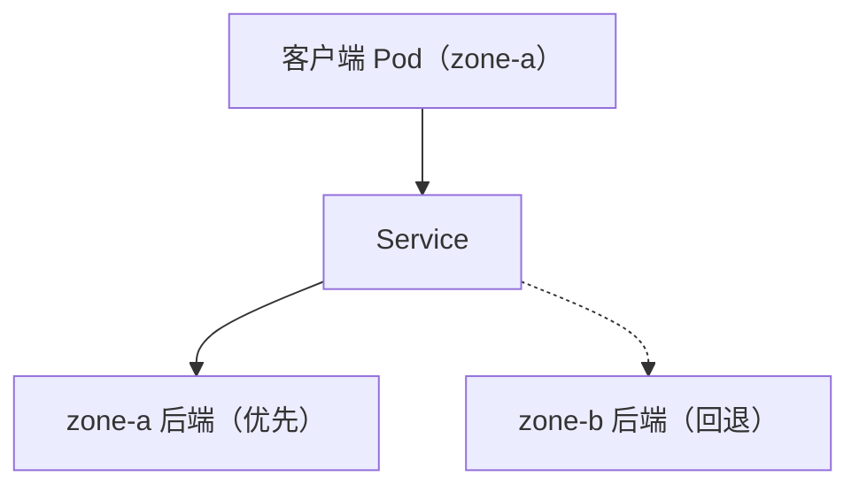

## Q
**就近路由**｜摘要 · 必会

集群内的流量想优先走同 node 或同 zone 的后端，有哪几种办法？「硬性规定」和「尽量」的区别是什么？

## A
| 手段 | 语义 | 没有本地后端时 |
|---|---|---|
| `internalTrafficPolicy: Local` | **硬规则**：只转给**同一 node** 的后端 | 对该 node 上的 Pod，Service 表现得像**没有后端**，连接失败 |
| `trafficDistribution: PreferSameZone` | **偏好**：优先同 zone | 回退到其他 zone 的后端 |
| `trafficDistribution: PreferSameNode` | **偏好**：优先同 node | 回退到远端后端 |
| `service.kubernetes.io/topology-aware-hints: Auto`（旧办法） | 给 EndpointSlice 的端点加 **hints**（`forZones`），kube-proxy 据此选择 | 需要足够多的端点才生效 |

```yaml
apiVersion: v1
kind: Service
metadata: {name: quote}
spec:
  selector: {app: quote}
  ports: [{port: 80, targetPort: 80}]
  trafficDistribution: PreferSameZone    # 优先同 zone，不够再跨 zone
```



- **为什么要就近：** 跨 zone 流量有延迟，也常常要付费。
- **Local 的用途：** 每个 node 有一个系统 Pod 管理本机设备，客户端必须连到本机的那个；Service IP 稳定，Pod IP 不稳定，所以用 Service。
- **前提：** node 要有 `topology.kubernetes.io/zone` 之类的 label，kube-proxy 才知道谁在哪个 zone。
- **和 `externalTrafficPolicy` 的区别：** 那个管**外部**进来的流量是否多跳一次；这里管**集群内部**的流量。

<details class="pt" markdown="1"><summary>出处</summary>

KIA2 §11.5.1–11.5.2；kubernetes.io Concepts › Service（Traffic distribution control）、Service Internal Traffic Policy

</details>
