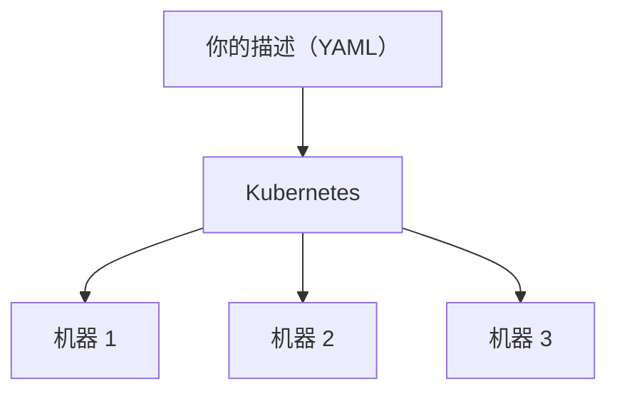
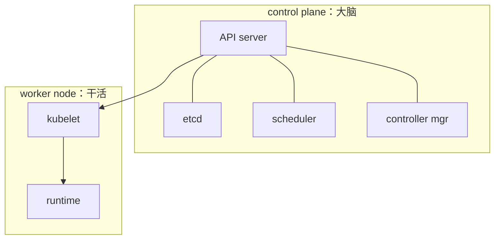
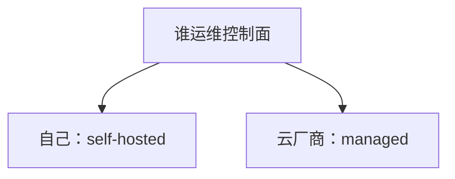

# 认识 Kubernetes

## 为什么需要它
一个应用在一台机器上跑，你亲自决定它放在哪、挂了怎么办。放到十台机器上，这些事就成了负担：放哪台、机器挂了谁补、升级怎么不停服、别人怎么找到它。**Kubernetes** 的想法是把一堆机器当成一台大计算机：你写下「我要什么」，它决定放在哪、看住它、坏了换掉。

它管的对象是 **container（容器）**：打包好的程序，和机器上别的进程隔离开。

## 集群里有什么
一个 **Cluster** 由两类机器组成：

- **API server**：所有请求的唯一入口。
- **etcd**：存放所有对象的数据库。
- **scheduler**：为新 Pod 挑机器。
- **controller manager**：跑着一批 controller，让现实对齐你的期望。
- **kubelet**：每台 node 上的代理，让 runtime 起容器。

生产环境一般有 3 或 5 个 control plane 节点。control plane 挂了，已经在跑的应用继续跑，但不能再扩缩、升级。

## 五个基本名词
| 名词 | 是什么 |
|---|---|
| Cluster | control plane 加若干 node |
| Node | 一台跑程序的机器 |
| Pod | 最小运行单位：一个或几个容器，共用一个 IP |
| Deployment | 声明「这个 Pod 要跑 N 份」 |
| Service | 一组 Pod 前面的固定地址 |

Pod 会死、会被换，IP 也跟着变，所以「要几份」交给 Deployment，「从哪访问」交给 Service。

## 自管还是托管

自己运维要精通所有组件的内部原理，出问题全归你；**managed** 服务（GKE、AKS、EKS 等）由厂商运维 control plane，你只用 API。版本上，**vanilla** 是社区原版，默认配置要自己调到能上生产；**extended 发行版**（OpenShift、Rancher）默认更安全，多一些对象类型，但通常落后上游一两个版本。服务很少（书里的经验是少于 5 个微服务）时，不上 Kubernetes 往往更划算。

**出处：** KIA2 §1.1–1.2、§3.3；Poulton ch1–2；KIA2 §1.3
