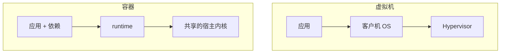
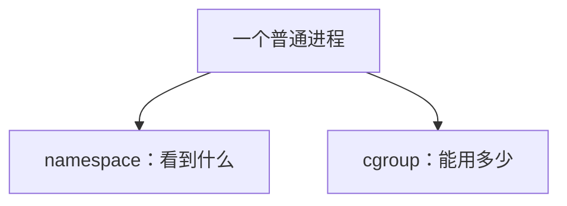
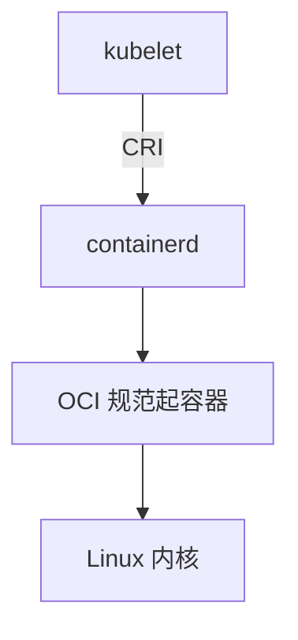

# 容器与它的底层

## 容器不是小虚拟机
**VM** 自带一整个客户机 OS，隔着 hypervisor；**container** 只是宿主机上的一个进程，所有容器共用同一个内核。



| | VM | Container |
|---|---|---|
| 内核 | 各带一个 | 共用宿主的 |
| 启动 | 要起一个 OS | 起一个进程 |
| 隔离 | 强 | 较弱 |
| 能跑什么 | 任何 OS | 要和宿主内核兼容 |

**Image** 是容器的安装包：应用和它需要的文件打成一个包，在哪里都能起出一样的容器。

## 进程怎么变成「容器」
Linux 内核里没有「容器」这个对象。它由两个机制拼出来：

- **namespace**：决定进程**看到什么**。每种资源一类：mnt（文件系统）、pid（进程号）、net（网卡和端口）、ipc、uts（主机名）、user（用户 ID）、time、cgroup。
- **cgroup**：决定进程**能用多少**，限制 CPU、内存、磁盘和网络带宽，由内核强制执行。



例子：

```bash
docker run --cpus="0.5" --memory="100m" ...   # 这两个选项只是在配置进程的 cgroup
```

容器里 `ps` 只看到自己的进程，是 pid namespace；内存超过 100MB 被杀，是 cgroup。

因为共用内核，容器的隔离不如 VM。要跑不信任的代码，需要更强的隔离（第 6 部分）。

## Image、registry 与 OCI
**image** 由只读的薄层叠成，容器在最上面多一层自己的可写层（改文件时整份复制过去）；相同的层本机只存一份。**Dockerfile** 一行指令一层：

```dockerfile
FROM node:23-alpine
COPY app.js /app.js
ENTRYPOINT ["node", "app.js"]
```

build 出的镜像 push 到 **registry**，node 上再 pull。删除文件只是在上层打标记，下面的层仍然带着它，所以大文件要在同一条指令里创建并删除。



**OCI** 规定镜像格式和 runtime 接口，**CRI** 是 kubelet 与 runtime 的接口，所以 Docker 构建的镜像能在任何兼容 runtime 上跑。容器权限靠 **capabilities**（把 root 权限拆成单项）和 **seccomp**（限制可调用的 system call）收紧；privileged 容器不受限，尽量不用。

**出处：** KIA2 §2.1、§2.3.1–2.3.4；KIA2 §2.1–2.3
