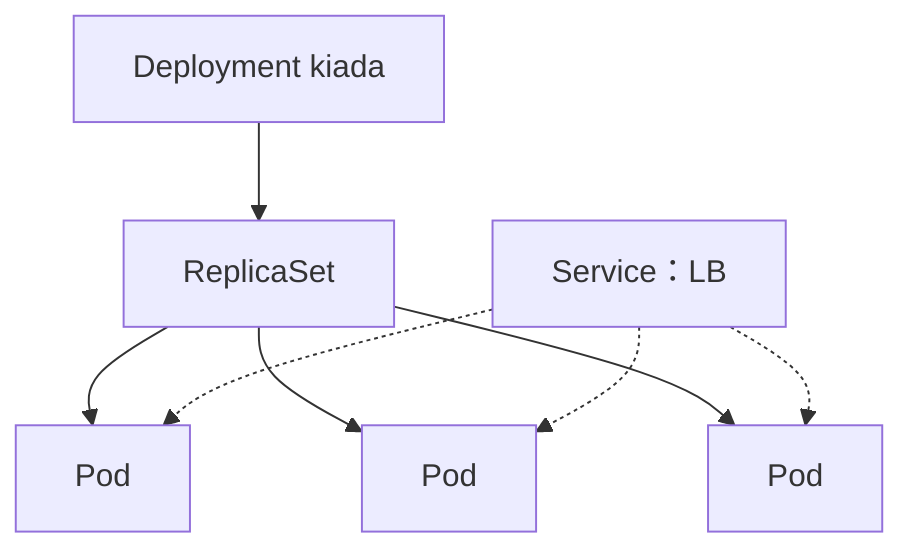

# 部署第一个应用

## kubectl
**kubectl** 是命令行工具，把每条命令变成一个 HTTP 请求，发给 API server。集群地址和你的身份写在 kubeconfig 文件里。

## 两种做法
```bash
# imperative：下命令
kubectl create deployment kiada --image=luksa/kiada:0.1
kubectl scale deployment kiada --replicas=3

# declarative：交一份想要的样子
kubectl apply -f kiada.yaml
```

| | Imperative | Declarative |
|---|---|---|
| 你说的 | 去做这一步 | 最后应该是这个样子 |
| 重复执行 | `create` 报 AlreadyExists | `unchanged` 或 `configured` |
| 适合 | 试验 | 正式环境，YAML 进 git |

```yaml
apiVersion: apps/v1
kind: Deployment
metadata: {name: kiada}
spec:
  replicas: 3
  selector:
    matchLabels: {app: kiada}
  template:
    metadata:
      labels: {app: kiada}
    spec:
      containers:
      - name: kiada
        image: luksa/kiada:0.1
```

## 第一次部署之后


```bash
kubectl expose deployment kiada --type=LoadBalancer --port 8080
kubectl get pods -o wide      # 多出 IP、NODE 两列
kubectl get svc kiada         # EXTERNAL-IP 先显示 <pending>
```

- Pod 名 = Deployment 名 + ReplicaSet 哈希 + 随机后缀。
- Pod 刚建出来是 Pending（node 在下载镜像），然后变 Running。
- 删掉一个 Pod，会有新的补回来：期望还是 3 个。要少一个，得改期望（`scale`）。
- `kubectl scale` 看起来像命令，其实是修改 Deployment 里的期望副本数。

**出处：** KIA2 §3.2–3.3
