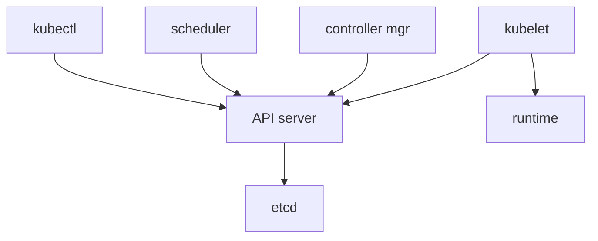
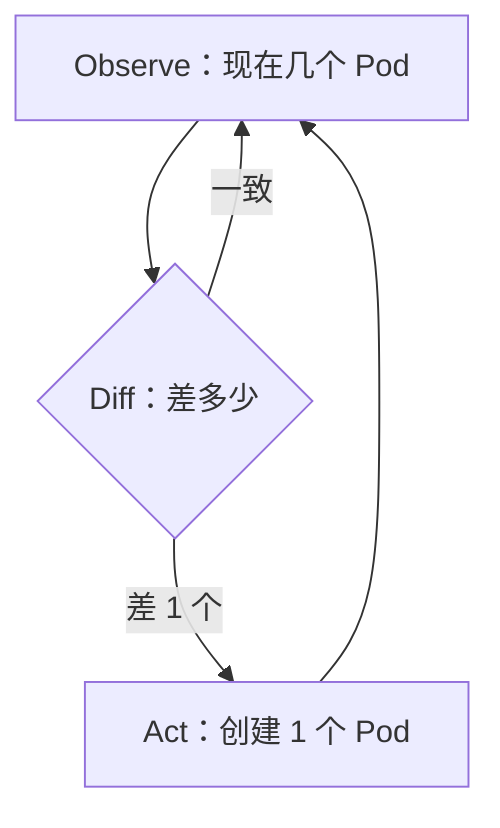
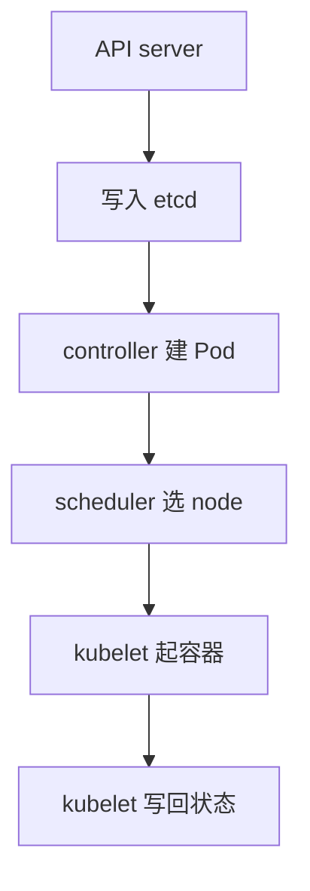

# 原理：control plane、controller 与 reconcile loop

## 组件与通信
所有组件只和 **API server** 说话；只有 API server 直接读写 **etcd**。



- scheduler 盯着没分配机器的 Pod，挑 node。
- controller manager 把 Deployment、ReplicaSet、Node 等 controller 跑在一个进程里。
- kubelet 盯着分给本机的 Pod，让 runtime 起容器，汇报状态。

## Controller 与 reconcile loop
**controller** 是一个一直在跑的程序，盯着某一类对象，发现现实和 `spec` 不一样，就改现实。



它是 **level-triggered**：只问「现在差多少」，不靠记住「刚才发生了什么事件」。重启、漏事件都不要紧，下一轮照样补齐。controller 只改**对象**；放哪台机器是 scheduler 的事，起容器是 kubelet 的事。

## 一条请求的旅程


没有总指挥：每个组件只看自己关心的对象，做完写回 API server，下一个靠 watch 看到变化接着做。所以排查时顺着链路找「最后一个正常的环节」。

```bash
kubectl get deploy,rs,pods       # 看链路上每一类对象在不在
kubectl describe pod <name>      # NODE 为空 → scheduler；有 NODE 起不来 → kubelet
```

**出处：** Poulton ch2；KIA2 §1.2.4；kubernetes.io Concepts › Controllers
