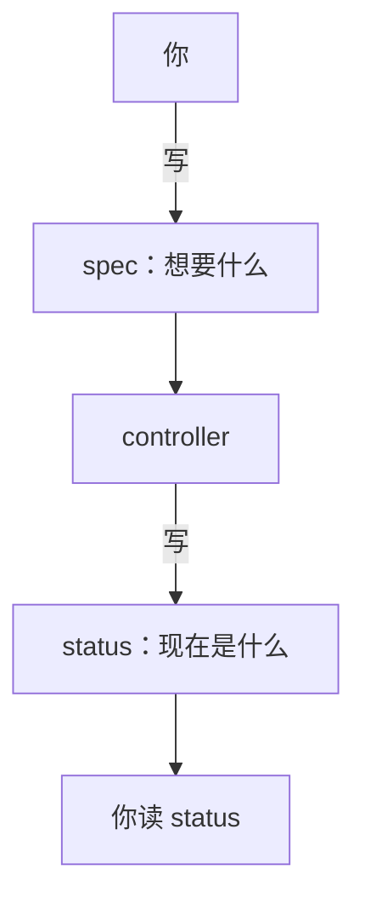

# API 与 object model

## 对象的骨架
每个对象都由同样几块组成：

```yaml
apiVersion: v1          # API 组/版本
kind: Pod               # 类型，首字母大写
metadata:               # 身份：名字、标签
  name: kiada
  labels: {app: kiada}
spec:                   # 期望状态：你写
  containers:
  - name: kiada
    image: luksa/kiada:0.1
status:                 # 实际状态：系统写
  phase: Running
```

Deployment 不在核心组，要写 `apiVersion: apps/v1`、`kind: Deployment`。`kubectl api-resources` 列出每种资源该写什么；`kubectl explain <类型>` 查字段。

## spec 与 status


reconcile 的两端：controller 读 `spec` 和现实，行动后把结果写进 `status`。手工改 `status` 没有意义，下一轮会被写回。

## conditions
`status.conditions` 是一个列表，每项有 `type`、`status`（True / False / Unknown）、`reason`、`message`。

| 值 | 意思 |
|---|---|
| Ready: False | node 汇报了「我不健康」 |
| Ready: Unknown | 很久没收到 node 的汇报 |

一个布尔值说不清哪里出问题；conditions 同时给多个独立维度，带上原因。`kubectl describe` 会把 Conditions 单独列出来，排查先看 `Reason` 和 `Message`。

**出处：** KIA2 §4.1–4.2
