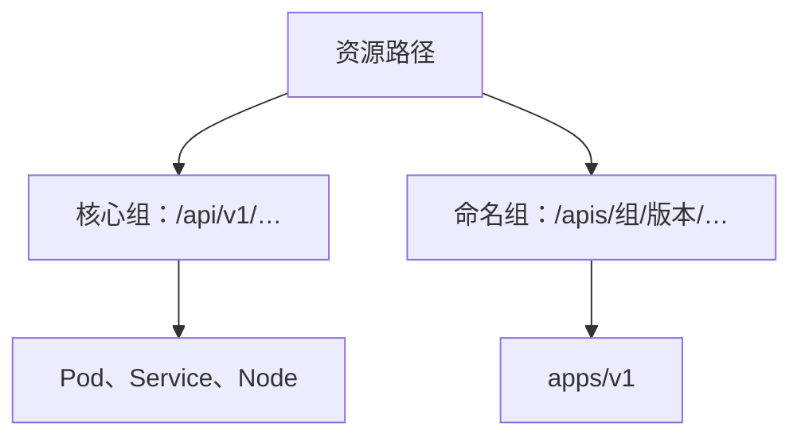
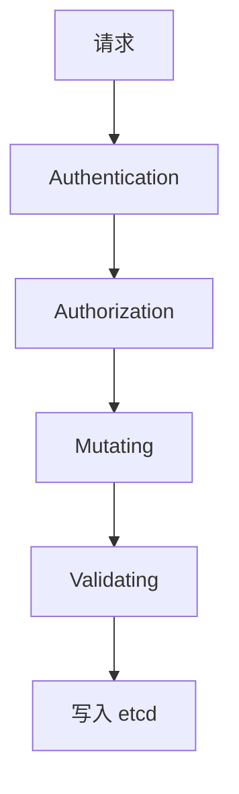

# Kubernetes API 与请求链路

## REST 路径
API server 暴露的是 HTTPS 上的 REST API。路径分两种：



| 资源 | 路径 |
|---|---|
| Pod | `/api/v1/namespaces/{ns}/pods/` |
| Node | `/api/v1/nodes/` |
| Deployment | `/apis/apps/v1/namespaces/{ns}/deployments/` |

`/api` 单数是核心组（最早的对象，没有组名）；新增资源都进 `/apis/<组>/<版本>`。属于命名空间的对象，路径多两段 `namespaces/{ns}/`。

```bash
kubectl api-resources            # 所有资源、简称、是否属于命名空间
kubectl get --raw /api/v1/nodes  # 直接发一个请求
```

## 请求链路


| 关卡 | 问什么 | 失败 |
|---|---|---|
| Authentication | 你是谁 | 401 |
| Authorization | 你能不能做这件事（RBAC：默认拒绝，规则才放行） | 403 |
| Mutating | 能不能改成合规 | 拒绝或改写 |
| Validating | 合不合规，只能放行或拒绝 | 拒绝 |

先 mutating 再 validating，是为了让校验看到改完之后的样子。看到准入层的报错，说明认证和鉴权已经过了。

**出处：** Poulton ch13–14；kubernetes.io Reference › Controlling Access to the Kubernetes API
