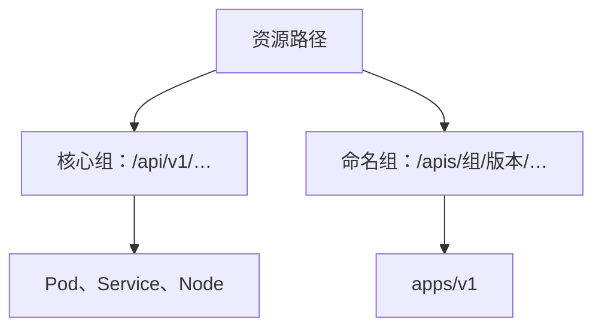
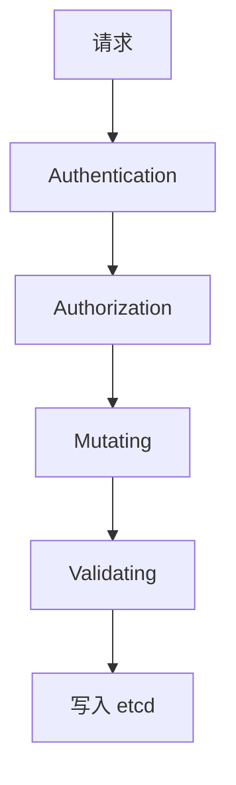
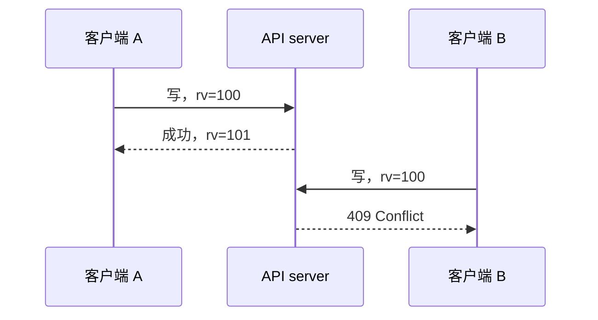
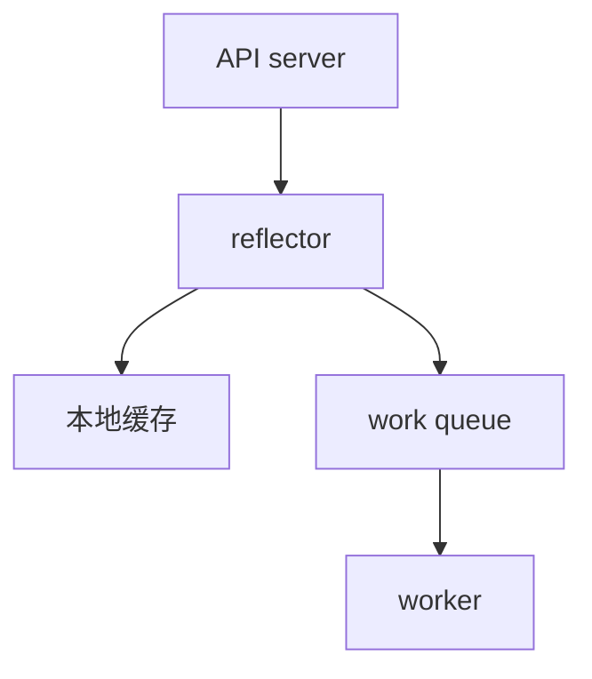

# Kubernetes API 与请求链路

## REST 路径
API server 暴露的是 HTTPS 上的 REST API。路径分两种：



| 资源 | 路径 |
|---|---|
| Pod | `/api/v1/namespaces/{ns}/pods/` |
| Node | `/api/v1/nodes/` |
| Deployment | `/apis/apps/v1/namespaces/{ns}/deployments/` |

`/api` 单数是核心组（最早的对象，没有组名）；新增资源都进 `/apis/<组>/<版本>`。属于命名空间的对象，路径多两段 `namespaces/{ns}/`。

```bash
kubectl api-resources            # 所有资源、简称、是否属于命名空间
kubectl get --raw /api/v1/nodes  # 直接发一个请求
```

## 请求链路


| 关卡 | 问什么 | 失败 |
|---|---|---|
| Authentication | 你是谁 | 401 |
| Authorization | 你能不能做这件事（RBAC：默认拒绝，规则才放行） | 403 |
| Mutating | 能不能改成合规 | 拒绝或改写 |
| Validating | 合不合规，只能放行或拒绝 | 拒绝 |

先 mutating 再 validating，是为了让校验看到改完之后的样子。看到准入层的报错，说明认证和鉴权已经过了。

## resourceVersion：乐观并发
对象存在 etcd 里，每个对象带 `metadata.resourceVersion`，标记它最后一次被改动时的版本。写入时带上读到的版本，若已被别人改过，API server 返回 **409 Conflict**；客户端应重新读、重新改、再写，而不是原样重发。



## Watch、informer 与 work queue
**watch** 让客户端发一次请求就持续收到变化事件。controller 用 **informer**：reflector 先 list 再 watch，把对象放进本地缓存，把变化对象的名字放进 **work queue**，worker 取一个名字、从缓存读当前对象、跑一轮 reconcile。watch 断得太久会收到 `410 Gone`，此时重新 list 全量再 watch。



## Server-side apply 与 finalizers
**server-side apply** 在 API server 上合并，用 `managedFields` 记录每个字段属于哪个 field manager；两个 manager 改同一字段会冲突，可以放弃字段或用 `--force-conflicts`。`kubectl apply --server-side -f x.yaml` 启用它。

删除分两步：先写 `deletionTimestamp`，再等 `metadata.finalizers` 清空才真正删除，所以带 finalizer 的对象会停在 `Terminating`。**ownerReferences** 记录谁创建了谁，owner 被删后，garbage collector 沿链清理依赖对象（Deployment → ReplicaSet → Pod）。

**出处：** Poulton ch13–14；kubernetes.io Reference › Controlling Access to the Kubernetes API；kubernetes.io Reference › API Concepts、Server-Side Apply；Concepts › Finalizers
