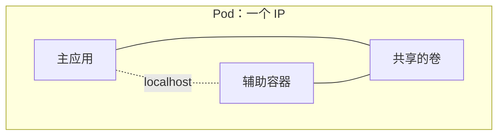
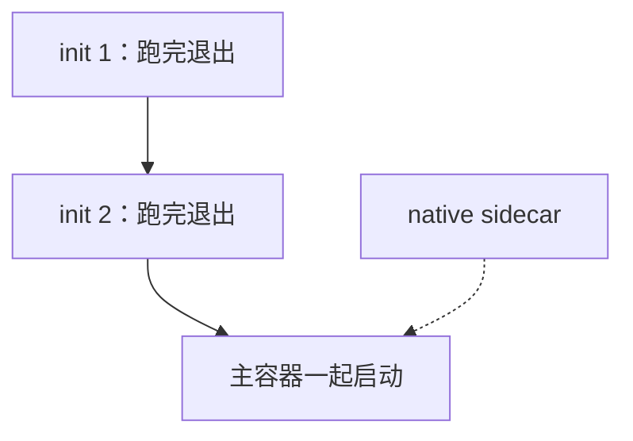

# 用 Pod 运行应用

## Pod 是什么
**Pod** 是调度和运行的最小单位：一个或几个容器，一定在同一台 node 上，共用一个 IP，可以共享卷。



紧密耦合、必须一起启动一起扩缩的容器放进同一个 Pod（应用加反向代理、应用加日志收集）。能独立扩缩的（前端和数据库）分开。

## 最小的 Pod
```yaml
apiVersion: v1
kind: Pod
metadata:
  name: kiada
spec:
  containers:
  - name: kiada
    image: luksa/kiada:0.1
```

## 排障四件事
```bash
kubectl logs kiada --previous                 # 崩溃前的日志
kubectl exec -it kiada -- sh                  # 进容器
kubectl port-forward pod/kiada 8080:8080      # 本机访问
kubectl debug -it kiada --image=busybox:1.36 --target=kiada   # 临时调试容器
```

镜像里没有 shell 时，`exec` 帮不上忙，用 `debug` 给运行中的 Pod 加一个临时容器。

## 启动顺序


- **init container**：按顺序跑，每个必须成功退出，主容器才启动。
- **native sidecar**：在 `initContainers` 里加 `restartPolicy: Always`。先于主容器启动，一直跑，关闭时最后退出（v1.33 GA）。

## Pod manifest
最小的 Pod manifest 只有 `apiVersion`、`kind`、`metadata.name` 和 `spec.containers`。`containerPort` 只是说明，不影响能否访问。创建后读回来的对象会多出默认值和 `status`。

```bash
kubectl apply -f pod.kiada.yaml
kubectl get pod kiada -o yaml
kubectl run kiada --image=luksa/kiada:0.1 --dry-run=client -o yaml > mypod.yaml   # 起草模板
```

Pod 的 spec 大部分字段不可变，改不了就删了重建；实际工作里改的是 Deployment 的模板。

**出处：** KIA2 §5.1–5.5；KIA2 §5.2
