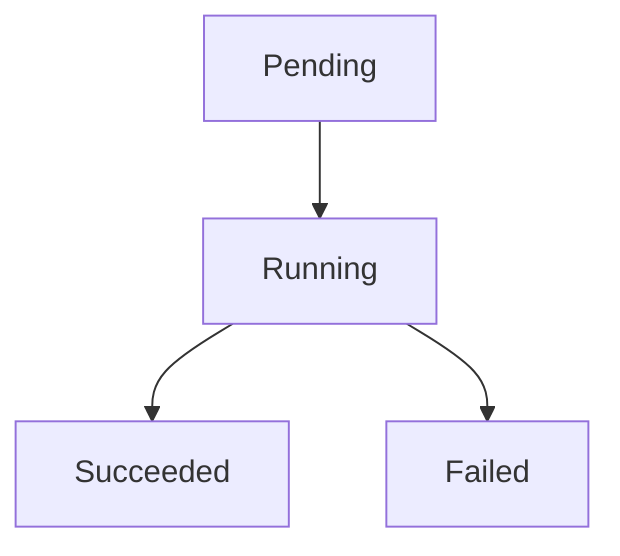
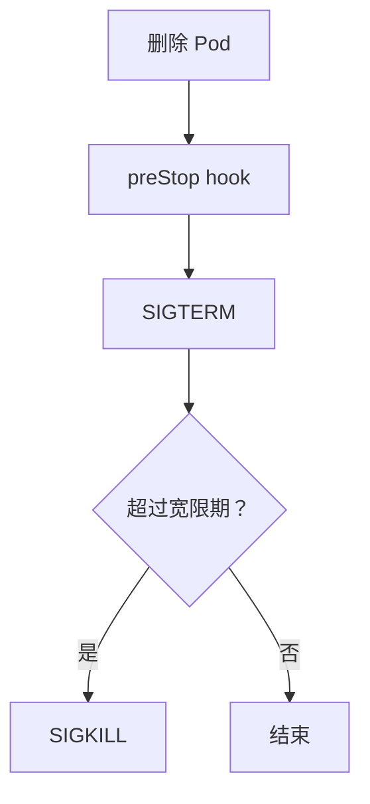

# Pod 的生命周期与健康

## 状态的三个层次


| 层次 | 取值 |
|---|---|
| phase | Pending / Running / Succeeded / Failed / Unknown |
| conditions | PodScheduled、Initialized、ContainersReady、Ready |
| container state | Waiting / Running / Terminated |

Running 只说明容器在跑。能不能接流量要看 **Ready**。

## 三种 probe
| Probe | 失败后果 |
|---|---|
| liveness | 重启容器 |
| readiness | 从 Service 后端摘掉，不重启 |
| startup | 通过之前，另外两种不执行 |

```yaml
livenessProbe:
  httpGet: {path: /healthz, port: 8080}
  periodSeconds: 5
  failureThreshold: 3
readinessProbe:
  httpGet: {path: /ready, port: 8080}
```

容器反复崩溃时，kubelet 的重启间隔指数增长：第一次没有延迟，然后 10 秒，每次翻倍，封顶 5 分钟，状态显示 `CrashLoopBackOff`。liveness 只查进程自己；检查外部依赖会让数据库故障时所有副本一起被重启。

## 优雅终止


宽限期 `terminationGracePeriodSeconds` 默认 30 秒。滚动发布出现 502：Pod 被删后，「发 SIGTERM」和「从 Service 摘掉」同时发生，应用退得比摘除传开更快。修法：preStop 里 `sleep` 几秒，并保证宽限期够长。

**出处：** KIA2 §6.1–6.4；kubernetes.io Concepts › Pod Lifecycle
