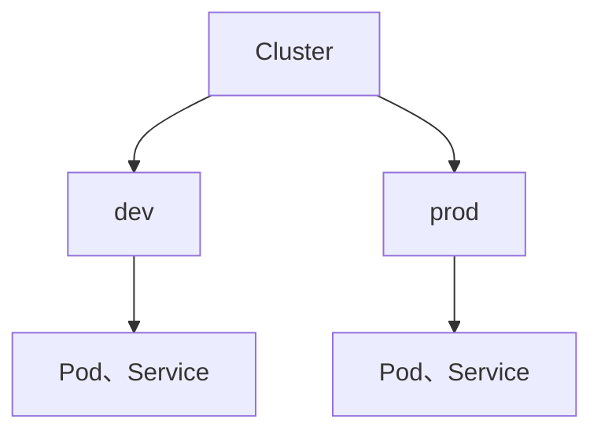
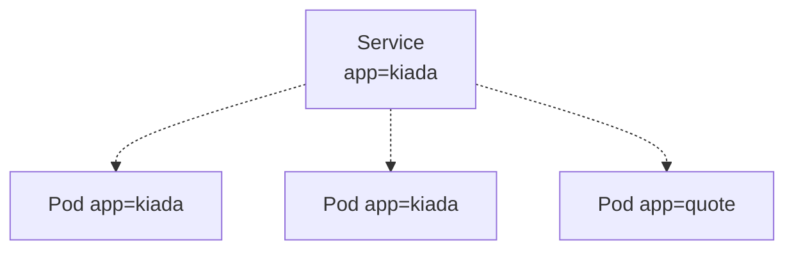

# Namespace 与 Label

## Namespace
**Namespace** 把集群里的对象分成逻辑分组，名字只需在组内唯一。它是组织和授权的边界，不是网络隔离：默认不同命名空间的 Pod 照样能互通。



```bash
kubectl get pods -n kube-system   # 指定命名空间
kubectl get pods -A               # 所有命名空间
kubectl create namespace dev
```

- 默认有 `default`、`kube-system`、`kube-public`、`kube-node-lease`。
- 跨命名空间访问 Service 要写 `<服务>.<命名空间>`，如 `db.dev`。
- Node 这类集群范围对象不属于任何命名空间。
- 删除命名空间会删掉里面所有对象。

## Label 与 selector
**Label** 是对象上的键值标签，**selector** 按标签挑对象。Service 靠它选后端，Deployment 靠它认领 Pod。



```bash
kubectl get pods -l app=kiada
kubectl label pod mypod rel=canary
```

选择方式：等值 `app=kiada`、不等 `rel!=canary`、集合 `app in (kiada, quote)`、存在 `rel`。

标签是松耦合：对象之间没有硬引用。把一个 Pod 的标签改掉，Service 会摘掉它，ReplicaSet 会补一个新的，原来的 Pod 继续跑但没人管了。

**出处：** KIA2 §7.1–7.3
