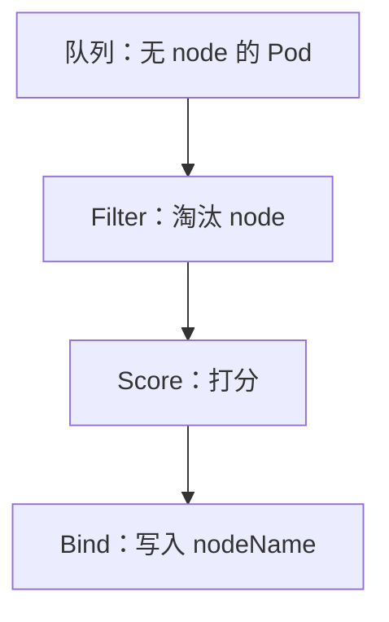
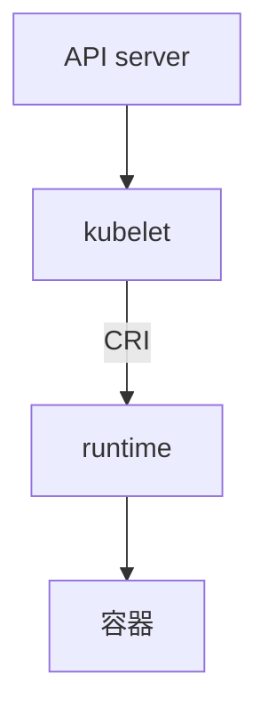
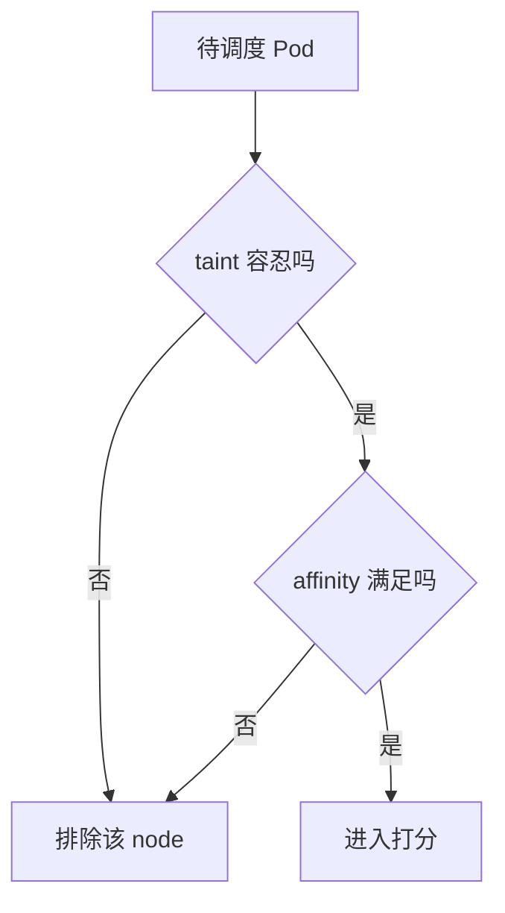

# Resources、scheduling 与 node

## requests 与 limits
```yaml
resources:
  requests: {cpu: 500m, memory: 256Mi}   # 调度用
  limits:   {cpu: "1",  memory: 512Mi}   # 封顶
```

- `requests`：调度器据此挑 node。
- `limits`：cgroup 强制执行。CPU 超了被限速；内存超了被 OOM kill。

| QoS class | 条件 | 驱逐顺序 |
|---|---|---|
| Guaranteed | 每个容器 CPU、内存的 request 都等于 limit | 最后 |
| Burstable | 不是 Guaranteed，但设了 request 或 limit | 中间 |
| BestEffort | 都没设 | 最先 |

## 调度


Filter 淘汰装不下的 node（剩余量不够 requests、有 taint、端口冲突）；Score 给剩下的打分；Bind 把 node 名写进 Pod。都不通过则 Pod 保持 Pending，Events 里写着 `Insufficient cpu` 之类的原因。调度只看 requests，不看实际使用量。

## kubelet 与驱逐


kubelet 通过 **CRI** 让 runtime 拉镜像、启停容器。node 资源低于阈值时，kubelet 会**提前**驱逐 Pod（soft：超阈值并持续一段宽限期；hard：立即）；内核 OOM killer 则是内存真的耗尽后**事后**杀进程。`OOMKilled` 是某个容器超了自己的 limit；`Evicted` 是整个 node 紧张。

## CPU throttling 与 OOM kill
limit 由内核按 cgroup 执行：CPU 超限被 **throttle**（变慢，不会死），memory 超限可能被 **OOM kill**（被动，内核紧张时才动手）。CPU 配额按周期发放，多线程突发很快用完，平均使用率低也会有延迟毛刺。

## 把 Pod 放到想要的 node


nodeSelector 和 node affinity 是 Pod 选 node；taint 是 node 拒绝 Pod，要带匹配的 toleration 才能进（`NoSchedule`、`PreferNoSchedule`、`NoExecute`）。**topology spread** 让同类 Pod 均匀分布：skew = 本 zone 的 Pod 数 − 全局最小值，必须 ≤ `maxSkew`（zone 里是 2、2、1，下一个 Pod 只能进 1 那个）。

## PriorityClass、preemption 与 PDB
Pod 放不下时，scheduler 可以驱逐低优先级 Pod 腾位置（**preemption**，由 PriorityClass 的 `value` 决定谁让谁）。**PodDisruptionBudget** 则限制计划内的主动驱逐（如 `kubectl drain`），用 `minAvailable` 或 `maxUnavailable` 保住最低可用数；`minAvailable` 写成副本总数会让 drain 永远卡住。

**出处：** kubernetes.io Concepts › Resource Management、Pod QoS、Node-pressure Eviction；Poulton ch2；kubernetes.io Concepts › Assigning Pods to Nodes、Taints and Tolerations、Topology Spread、Pod Priority、Disruptions
