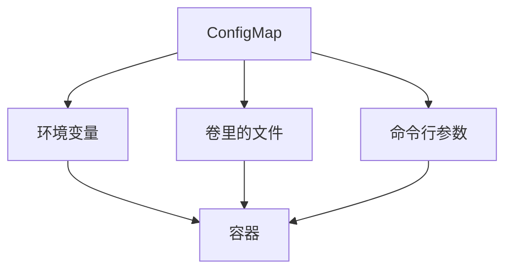
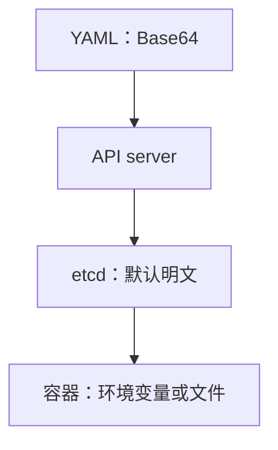

# 用 ConfigMap 与 Secret 配置应用

## ConfigMap
同一个镜像要在不同环境用不同配置。把配置放进 **ConfigMap**，Pod 引用它，配置和 Pod manifest 解耦。

```yaml
apiVersion: v1
kind: ConfigMap
metadata: {name: kiada-config}
data:
  log-level: "debug"
```



```yaml
env:
- name: LOG_LEVEL
  valueFrom:
    configMapKeyRef: {name: kiada-config, key: log-level}
```

更新语义不同：环境变量在容器启动时定下来，ConfigMap 改了，运行中的 Pod 仍是旧值，要重启容器才生效；卷里的文件会被 kubelet 同步，用符号链接原子替换，但应用要自己重读。

## Secret
**Secret** 的值是 Base64 编码，**不是加密**。

```bash
echo 'cGFzc3dvcmQ=' | base64 -d     # password
```



- etcd 默认不加密存储，要另外开启静态加密。
- 谁能读取由 RBAC 决定，权限配松就会泄露。
- 不自动轮换。
- 更稳妥：etcd 静态加密、收紧 RBAC、外部密钥管理工具（如 Vault）。

## command、args 与 env
镜像的 `ENTRYPOINT` 对应 Pod 的 `command`，`CMD` 对应 `args`，最终命令是两者拼接。manifest 里写了哪个就替换哪个：

```yaml
containers:
- name: kiada
  image: luksa/kiada:0.4
  args: ["--listen-port", "9090"]   # 实际：node app.js --listen-port 9090
  env:
  - {name: INITIAL_STATUS_MESSAGE, value: "hello"}
```

环境变量按容器设置。数组里的 `yes`、`true`、数字要加引号。

## Downward API
把 Pod 自己的元数据注入容器，用环境变量或 downwardAPI 卷（不用调 API server）：

```yaml
env:
- name: POD_NAME
  valueFrom: {fieldRef: {fieldPath: metadata.name}}
- name: MAX_MEMORY_KB
  valueFrom: {resourceFieldRef: {resource: limits.memory, divisor: 1k}}
```

只支持部分字段：`spec.nodeName`、Pod IP 只能进环境变量；全部 labels 只能进文件。

**出处：** KIA2 §8.2–8.3；KIA2 §8.1、§8.4
