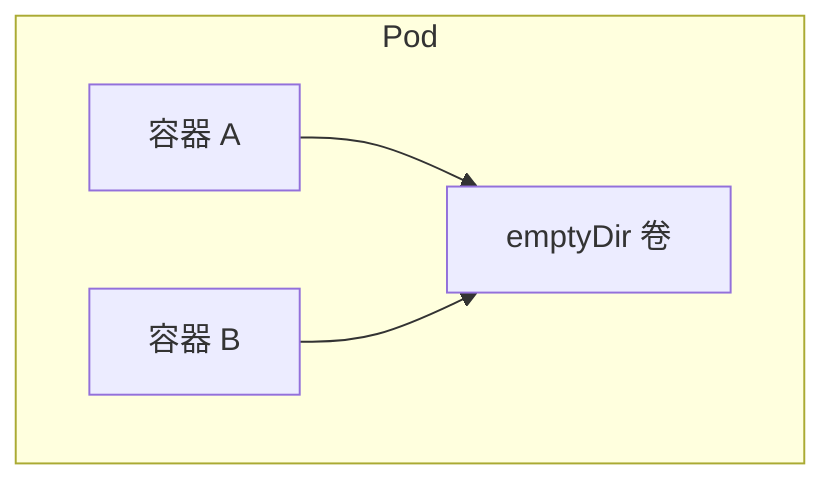

# Volume 与 emptyDir

容器的文件系统是临时的：容器重建，里面写的东西就没了。**Volume** 是 Pod 级的目录，挂进容器后，容器重启它还在。



```yaml
spec:
  volumes:
  - name: shared
    emptyDir: {}
  containers:
  - name: app
    image: kiada:1.0
    volumeMounts:
    - {name: shared, mountPath: /data}
```

| 事件 | emptyDir 里的文件 |
|---|---|
| 容器重启 | 还在 |
| Pod 被删、重建，或换 node | 没了 |
| 同 Pod 的其他容器 | 能共享 |
| 其他 Pod | 不能共享 |

卷绑定的是 **Pod**，不是容器。emptyDir 适合：容器重启后还要的临时数据、给只读根文件系统的容器一个能写的目录、容器之间共享文件。要让数据比 Pod 活得久，用下一章的 PersistentVolume。

**出处：** KIA2 §9.1–9.2
