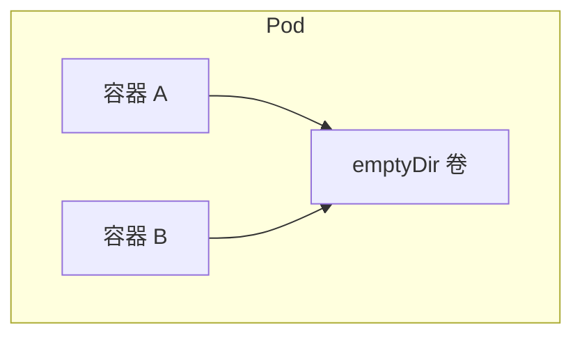
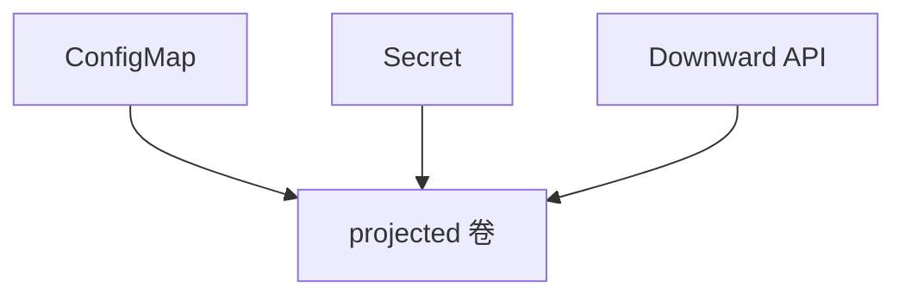

# Volume 与 emptyDir

容器的文件系统是临时的：容器重建，里面写的东西就没了。**Volume** 是 Pod 级的目录，挂进容器后，容器重启它还在。



```yaml
spec:
  volumes:
  - name: shared
    emptyDir: {}
  containers:
  - name: app
    image: kiada:1.0
    volumeMounts:
    - {name: shared, mountPath: /data}
```

| 事件 | emptyDir 里的文件 |
|---|---|
| 容器重启 | 还在 |
| Pod 被删、重建，或换 node | 没了 |
| 同 Pod 的其他容器 | 能共享 |
| 其他 Pod | 不能共享 |

卷绑定的是 **Pod**，不是容器。emptyDir 适合：容器重启后还要的临时数据、给只读根文件系统的容器一个能写的目录、容器之间共享文件。要让数据比 Pod 活得久，用下一章的 PersistentVolume。

## 配置类 volume 与 projected 卷
配置以文件形式给容器有四种 volume：`configMap`、`secret`、`downwardAPI`，以及能把它们合并进同一个目录的 **projected**。挂载点原有的文件会被遮住，所以不要把 ConfigMap 挂到 `/etc` 这样的目录；用 `subPath` 挂单个文件，则不会随源更新。



## hostPath 与 image volume
**hostPath** 挂 node 的文件系统，Pod 换 node 内容就变，而且权限极大（挂 `/` 等于拿到 node），只留给系统级 Pod。**image volume** 把 OCI 镜像里的文件只读挂进容器，适合分发模型和静态数据（v1.36 GA）。

**出处：** KIA2 §9.1–9.2；KIA2 §9.3–9.5
