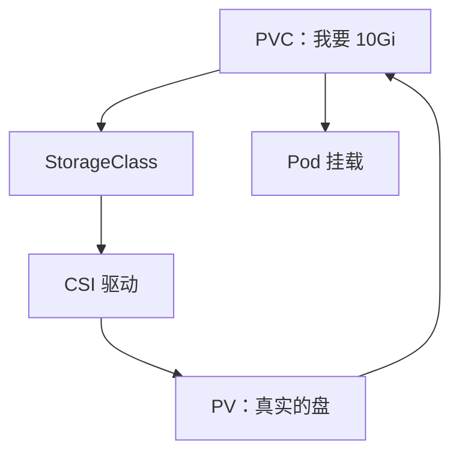

# PersistentVolume 与 dynamic provisioning

开发者声明「我要 10Gi」，管理员或驱动负责提供。三个对象：

| 对象 | 谁创建 | 是什么 |
|---|---|---|
| PersistentVolume（PV） | 管理员，或动态供给时自动 | 集群里的一块存储，不属于命名空间 |
| PersistentVolumeClaim（PVC） | 开发者 | 存储的申请，属于命名空间 |
| StorageClass | 管理员 | 一类存储的模板：provisioner、参数、绑定时机 |



```yaml
apiVersion: v1
kind: PersistentVolumeClaim
metadata: {name: quiz-data}
spec:
  accessModes: [ReadWriteOnce]
  storageClassName: standard
  resources:
    requests: {storage: 10Gi}
---
# Pod 里引用：
#   volumes:
#   - name: data
#     persistentVolumeClaim: {claimName: quiz-data}
```

**动态供给**：创建 PVC 时，provisioner 按 StorageClass 自动创建底层存储和 PV 并绑定。

**绑定模式**：`Immediate` 是 PVC 一创建就供给；`WaitForFirstConsumer` 是等第一个使用它的 Pod 被调度后再供给。云硬盘通常只能挂到同一可用区的 node，后者让卷建在 Pod 所在的位置，避免错位。所以这种模式下 PVC 在 Pod 出现前显示 `Pending` 是正常的。

**CSI 驱动**是具体存储技术的实现：controller 部分创建卷，每个 node 上的部分负责挂载、卸载。

**出处：** KIA2 §10.1–10.2
