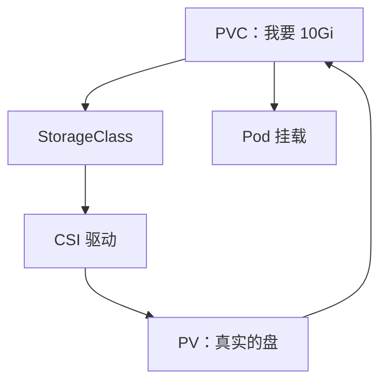
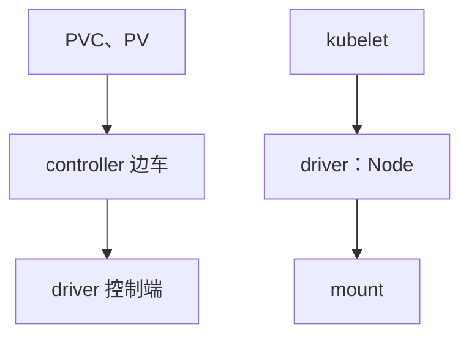

# PersistentVolume 与 dynamic provisioning

开发者声明「我要 10Gi」，管理员或驱动负责提供。三个对象：

| 对象 | 谁创建 | 是什么 |
|---|---|---|
| PersistentVolume（PV） | 管理员，或动态供给时自动 | 集群里的一块存储，不属于命名空间 |
| PersistentVolumeClaim（PVC） | 开发者 | 存储的申请，属于命名空间 |
| StorageClass | 管理员 | 一类存储的模板：provisioner、参数、绑定时机 |



```yaml
apiVersion: v1
kind: PersistentVolumeClaim
metadata: {name: quiz-data}
spec:
  accessModes: [ReadWriteOnce]
  storageClassName: standard
  resources:
    requests: {storage: 10Gi}
---
# Pod 里引用：
#   volumes:
#   - name: data
#     persistentVolumeClaim: {claimName: quiz-data}
```

**动态供给**：创建 PVC 时，provisioner 按 StorageClass 自动创建底层存储和 PV 并绑定。

**绑定模式**：`Immediate` 是 PVC 一创建就供给；`WaitForFirstConsumer` 是等第一个使用它的 Pod 被调度后再供给。云硬盘通常只能挂到同一可用区的 node，后者让卷建在 Pod 所在的位置，避免错位。所以这种模式下 PVC 在 Pod 出现前显示 `Pending` 是正常的。

**CSI 驱动**是具体存储技术的实现：controller 部分创建卷，每个 node 上的部分负责挂载、卸载。

## Access modes 与 reclaim policy
RWO 按 **node** 限制（同 node 的多个 Pod 能共用），RWOP 按 **Pod** 限制，ROX 多 node 只读，RWX 多 node 读写。删 PVC 后：`Delete` 连底层存储一起删，`Retain` 让 PV 进入 **Released**，不会自动被新 PVC 认领，需要删了重建 PV（或去掉 `claimRef`）。

## CSI：controller 与 node 两部分


controller 部分（Deployment）带 `external-provisioner`、`external-attacher`、`external-resizer`、`external-snapshotter` 等 sidecar，监听 Kubernetes 对象再调 driver；node 部分以 DaemonSet 每 node 一个，负责 mount，并用 `node-driver-registrar` 注册给 kubelet。

## 扩容、快照与 ephemeral volume
扩容改 PVC 的 `requests.storage`（只能增大，需 StorageClass 允许），完成文件系统扩容要重启 Pod。快照用 `VolumeSnapshot` 指向 PVC，恢复时新 PVC 的 `dataSource` 指向它。`ephemeral` volume 按模板为 Pod 建一个专属 PVC，随 Pod 消失，比 emptyDir 多了固定大小和快照等能力。

**出处：** KIA2 §10.1–10.2；KIA2 §10.2–10.5；kubernetes-csi.github.io
