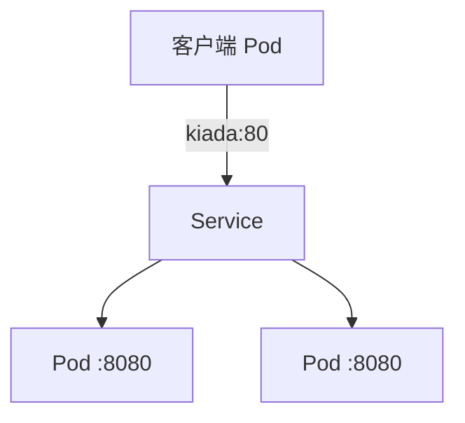
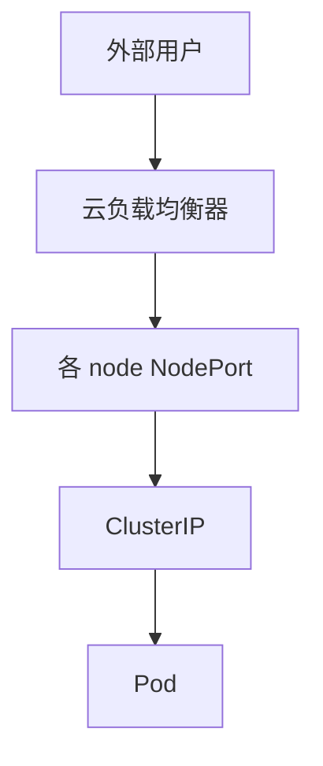

# 用 Service 暴露 Pod

## ClusterIP
Pod 的 IP 随时会变。**Service** 给一组 Pod 一个不变的虚拟 IP（ClusterIP）和 DNS 名字，流量被转发到当前健康的后端。

```yaml
apiVersion: v1
kind: Service
metadata: {name: kiada}
spec:
  selector: {app: kiada}
  ports:
  - port: 80          # Service 的端口
    targetPort: 8080  # Pod 的端口
```



每个 node 上的 kube-proxy 监听 Service 和 EndpointSlice，在内核里写规则，把发往 ClusterIP 的流量改写到某个 Pod IP。selector 选不到 Pod 时不会报错，只是后端为空。

## 对外暴露


LoadBalancer 建立在 NodePort 上，NodePort 建立在 ClusterIP 上。NodePort 的端口范围一般是 30000–32767。`externalTrafficPolicy` 决定 node 收到外部流量后转给谁：

| | Cluster（默认） | Local |
|---|---|---|
| 转发给 | 所有 Pod，可能跨 node | 只给本 node 的 Pod |
| 客户端 IP | 被替换 | 保留 |
| 代价 | 多一跳 | 分布可能不均，没有本地 Pod 的 node 会让请求挂住 |

## 后端从哪来
Service 的后端列表放在 **EndpointSlice** 里，每个地址带「是否就绪」。Pod 的 readiness probe 失败，就从后端摘掉。没有 readiness probe 的 Pod 一启动就被当成后端，滚动发布时会有请求落在没准备好的新 Pod 上。`Endpoints` API 自 v1.33 弃用，改读 EndpointSlice。

```bash
kubectl get endpointslices -l kubernetes.io/service-name=kiada
```

**出处：** KIA2 §11.1–11.3；Poulton ch9
