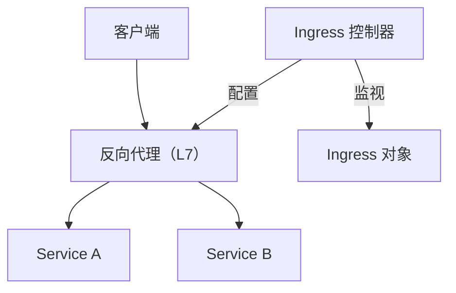

# Ingress：用一个入口路由多个 HTTP 服务

## 为什么需要 Ingress
每个 LoadBalancer Service 要一个云负载均衡器和一个公网 IP。想让多个 HTTP 服务共用一个入口，就用 **Ingress**：按请求里的 host 和 path 把流量分给不同的 Service。

## 三个组成部分


- **Ingress 对象：** 写规则的 API 对象。
- **反向代理（L7 负载均衡器）：** 真正转发 HTTP 流量的进程。
- **Ingress controller：** 盯着 Ingress 对象，部署并配置代理。**集群默认不带，要自己装**；没有 controller，Ingress 对象不会有任何效果。

## 一个例子
```yaml
apiVersion: networking.k8s.io/v1
kind: Ingress
metadata: {name: api-example-com}
spec:
  ingressClassName: nginx
  tls:
  - secretName: tls-example-com      # 在代理处终止 TLS
    hosts: ["*.example.com"]
  rules:
  - host: api.example.com
    http:
      paths:
      - {path: /quote, pathType: Exact, backend: {service: {name: quote, port: {name: http}}}}
      - {path: /questions, pathType: Prefix, backend: {service: {name: quiz, port: {name: http}}}}
```

- 请求靠 **Host 头**选规则，所以用 IP 直接访问会 404：`curl --resolve api.example.com:80:<Ingress IP> http://api.example.com/quote`。
- `pathType` 必须写：`Exact` 完全相等，`Prefix` 按 `/` 分段的前缀，`ImplementationSpecific` 由 controller 决定；区分大小写，同时命中时 `Exact` 优先。
- 通配符 host `*.example.com` 只覆盖一段域名标签。
- 没有规则命中就走 default backend，没有就 404；默认不改写 URL。

## annotation 与 IngressClass
Ingress 的标准字段很少，会话保持、改写、TLS passthrough 都靠 controller 私有的 **annotation**（如 `nginx.ingress.kubernetes.io/affinity: cookie`），换 controller 就失效。**IngressClass** 对象指明由哪个 controller 处理，Ingress 用 `ingressClassName` 引用。

## 2026：Ingress 的现状
Ingress API 已 **frozen**：仍是 GA、不会被移除，但不再开发。Kubernetes 项目的 **Ingress NGINX** 于 **2026-03-24 退役**，不再有更新和安全修复。官方建议新项目用 Gateway API（见下一章）。

**出处：** KIA2 ch12；kubernetes.io Concepts › Ingress；博客 2025-11-11「Ingress NGINX Retirement」；v1.36 发布博客
