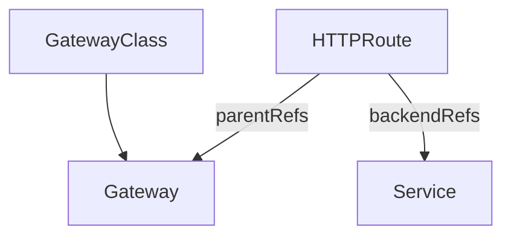

# 用 Gateway API 路由流量

## 为什么取代 Ingress
Ingress 把路由和入口基础设施放在一个对象里，高级能力靠各控制器私有的 annotation，换控制器就要重写。Ingress NGINX 于 2026-03-24 退役。**Gateway API** 按角色拆成几个对象，权重切分、header 匹配写在标准字段里，v1.0 于 2023-10-31 GA。

| | Ingress | Gateway API |
|---|---|---|
| 对象 | 一个 | GatewayClass、Gateway、HTTPRoute |
| 高级路由 | 私有 annotation | 标准字段 |
| 协议 | 主要 HTTP | HTTP、HTTPS、gRPC |

Gateway API 只是规范，没有默认实现，要自己装一个（Cilium、Envoy、Istio、NGINX、Traefik 等）。

## 三个对象


| 对象 | 谁管 | 作用 |
|---|---|---|
| GatewayClass | 基础设施提供者 | 关联到某个实现 |
| Gateway | 集群运维 | 监听端口，控制器据此创建负载均衡器 |
| HTTPRoute | 应用开发者 | 主机名、路径、header 匹配，转发到 Service |

```yaml
apiVersion: gateway.networking.k8s.io/v1
kind: HTTPRoute
metadata: {name: kiada}
spec:
  parentRefs: [{name: my-gateway}]
  hostnames: ["kiada.example.com"]
  rules:
  - backendRefs:
    - {name: kiada-v1, port: 8080, weight: 90}
    - {name: kiada-v2, port: 8080, weight: 10}
```

排查看 status conditions：Gateway 的 `Accepted`、`Programmed`；HTTPRoute 的 `Accepted`（父 Gateway 是否接受）、`ResolvedRefs`（后端引用是否解析成功）。

**出处：** Poulton ch8；KIA2 ch13
