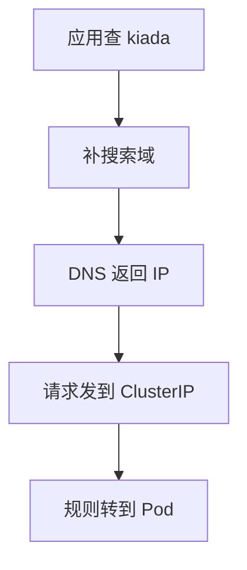
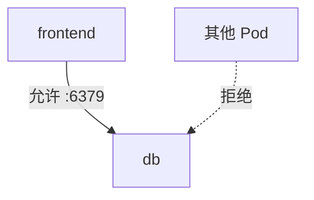

# Service discovery 与 NetworkPolicy

## 集群 DNS
每个容器的 `/etc/resolv.conf` 都被配置成向集群 DNS（CoreDNS）问路，并带上搜索域：

```bash
search default.svc.cluster.local svc.cluster.local cluster.local
nameserver 10.96.0.10
options ndots:5
```



Service 一创建，集群 DNS 里就有了它的名字，集群 DNS 就是服务注册表。短名字 `kiada` 被补成 `kiada.default.svc.cluster.local`。

`ndots:5` 的代价：名字里点少于 5 个，会先逐个拼搜索域查询，失败后才查原名。`api.example.com` 一次解析变成 4 次查询。缓解：写 `api.example.com.`（结尾加点），或在 Pod 的 `dnsConfig` 里调低 ndots。

排查按层走：`nslookup <服务>`（DNS）→ EndpointSlice（有没有后端）→ Pod 是否 Ready。

## NetworkPolicy
默认任何 Pod 都能连任何 Pod。**NetworkPolicy** 变成白名单：Pod 被某个策略选中后，只有策略允许的连接才能通过。

```yaml
apiVersion: networking.k8s.io/v1
kind: NetworkPolicy
metadata: {name: db-allow-frontend}
spec:
  podSelector:
    matchLabels: {role: db}
  policyTypes: [Ingress]
  ingress:
  - from:
    - podSelector:
        matchLabels: {role: frontend}
    ports:
    - {protocol: TCP, port: 6379}
```



- 多个策略选中同一个 Pod，允许的是并集，没有顺序。
- 入站和出站各自独立；A 连 B 要 A 的出站和 B 的入站都放行；回包自动放行。
- 由网络插件（CNI）执行。插件不支持，策略**不起作用**，也没有提示。

**出处：** Poulton ch9；kubernetes.io Concepts › Network Policies
