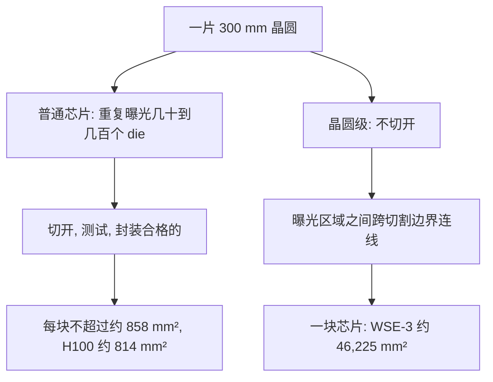

## Q
什么是晶圆级芯片（wafer-scale engine）？它和普通 GPU 芯片在制造上有什么根本不同？用 WSE-3 的数字说明它有多大。

## A
**普通芯片怎么来的：** 芯片在一片直径 300 毫米的圆形硅片（晶圆，wafer）上制造。光刻机一次只能曝光一个有限的区域（光罩极限，reticle limit，约 26 × 33 毫米，约 858 平方毫米），所以晶圆上重复制造几十到几百个相同的小芯片（die），最后切开、测试、把合格的封装成独立的芯片。GPU 再大也不能超过这个面积：H100 的芯片约 814 平方毫米、约 800 亿个晶体管。

**晶圆级芯片：** 不切开，把整片晶圆上能用的最大正方形区域做成**一块**芯片。各个曝光区域之间的连线跨越原本用来切割的边界，把它们连成一个整体。

**WSE-3（Cerebras 第三代晶圆级引擎，2024 年发布）的数字：**
- 面积约 **46,225 平方毫米**，是 H100 芯片的 50 多倍；
- 约 **4 万亿个晶体管**，台积电 5 纳米工艺；
- **90 万个**计算核心，由 84 个曝光区域拼成；
- **44 GB 片上 SRAM**（做在计算芯片里的高速存储，GPU 全卡的片上 SRAM 只有几十 MB）；
- 片上存储总带宽约 **21 PB/s**（每秒 21 千万亿字节），核心之间的片上互连带宽约 214 Pb/s（注意是比特）；
- 厂商标称峰值 AI 算力 125 PFLOPS。

**为什么要这么做：** 芯片和芯片之间的通信（经过封装、电路板、线缆）比芯片内部的通信慢得多、费电得多。把原本需要几十块 GPU 加高速网络才能完成的工作放在一块硅片上，数据大部分时间在片内移动。

**整机：** WSE-3 装在 CS-3 系统里。这台机器为这一块晶圆提供供电、液冷和对外的网络接口；多台 CS-3 可以通过网络组成集群。

**代价：** 44 GB 的片上存储虽然极快，但容量远小于一块 GPU 的 80–180 GB 显存；超过这个大小的模型必须分到多片晶圆上，或者把参数放到外部存储里按需送入。
