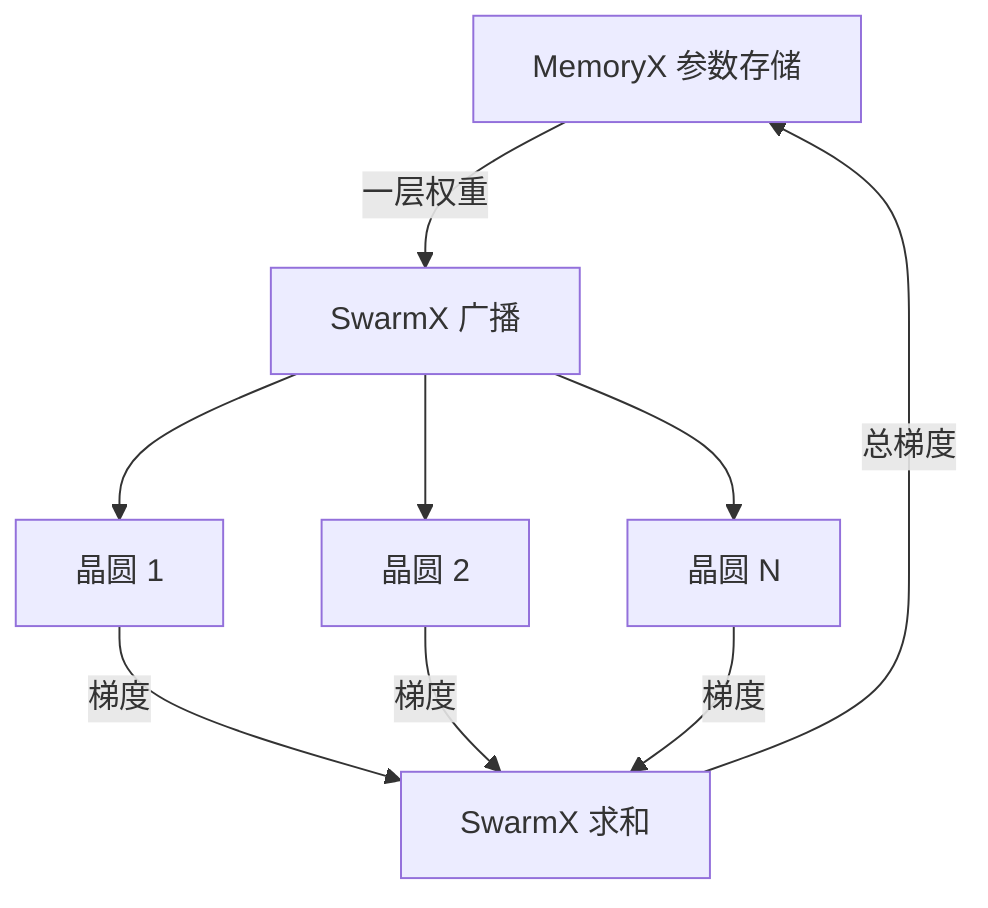

## Q
多台晶圆级系统一起训练时，SwarmX 负责什么？为什么这种架构只需要数据并行，而不需要把模型切到多台机器上？

## A
**数据并行（data parallelism）：** 每台机器运行完全相同的模型，各自处理一批数据中的不同部分，算出各自的梯度（损失对每个参数的导数），再把所有机器的梯度加起来，用总梯度更新同一份参数。

**SwarmX 的两个动作：**
- **广播（broadcast）：** 每一层的权重从 MemoryX（外部参数存储）出来后，由 SwarmX 同时发送给所有参与训练的晶圆。
- **归约（reduce）：** 每片晶圆算出这一层的梯度后，SwarmX 把所有晶圆的梯度相加，把总和交给 MemoryX 去更新参数。它还把各台机器的损失值汇总后交给用户侧。

**为什么只需要数据并行：**
- 在权重流式执行中，每片晶圆一次只需放下一层的权重和激活值。只要一层能放下，整个模型就能在一片晶圆上训练，不需要把模型拆到多台机器上。
- GPU 训练大模型时，一块卡放不下整个模型及其优化器状态，所以要组合张量并行（每层的矩阵切到多卡）、流水线并行（按层切到多卡）和数据并行，配置复杂，换个规模就要重新调。
- 这里加机器只是让每台处理更少的数据（或者整体处理更大的批），模型代码和切分方式不变。

**扩展的代价与限制：**
- 所有机器的梯度每一层都要汇总，SwarmX 的带宽和延迟决定扩展效率。
- 每台机器处理的数据量不能太少，否则每次送入的权重被复用的次数太少，外部链路成为瓶颈。

**测试关注点：** 1 台和 N 台训练同一模型，相同的总批大小下损失曲线应基本重合；梯度求和的正确性可以用"N 台的总梯度 = 单台处理全部数据的梯度"在小模型上验证。
