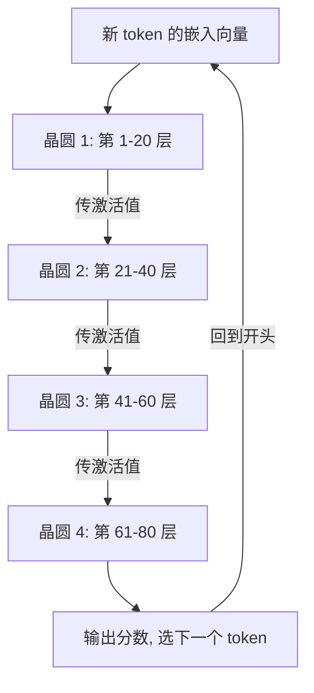

## Q
当模型放在片上 SRAM、一片放不下时，模型是怎样切到多片晶圆上执行的？为什么只需要在片之间传激活值？画出一个 token 的流动过程。

## A
**片内：层映射到区域。** 在一片晶圆上，编译器把每一层分配到核心网格的一块区域，区域大小按这一层的参数量和计算量决定。这一层的权重就存放在这块区域核心的本地 SRAM（每个核心自带的高速存储）里。相邻的层放在物理上相邻的区域，一个 token 的中间结果（激活值）从第 1 层的区域流到第 2 层的区域，依次穿过整个模型。最后一层的输出变成下一个 token，再送回第 1 层。

**片间：在层的边界切开。** 模型参数超过一片的 44 GB 时，按层的边界切成几段，每段放一片晶圆。例如 70B 模型 FP16 约 140 GB，切成 4 段，每片约 20 层。

**为什么只传激活值：**
- 每片晶圆完整地持有自己那几层的全部权重，以及这些层的 KV 缓存（每个请求历史 token 在这些层的键、值向量）。所以一层内部的所有计算和通信都在片内完成。
- 片与片之间需要交接的，只有"上一段算完后这个 token 的隐藏向量"。70B 模型的隐藏宽度是 8,192，FP16 下每个 token 只有 **16 KB**。
- 对比 GPU 上的张量并行：每层都要在卡间合并部分结果，80 层每步上百次通信。

**片间链路：** 通过以太网上的 RDMA（远程直接内存访问，网卡直接读写对方内存，不经过操作系统）连接，每跳延迟为微秒级。16 KB 在 100 Gb/s 的链路上传输只要约 1.3 微秒。

**这种切法的特点：**
- 通信量小，对片间带宽要求低，所以片外 I/O 有限也能工作。
- 一个 token 仍然要串行经过所有晶圆，片越多，每个 token 的路径越长。单用户速度不会因为加片而变快，加片只是为了放得下。
- 要让所有晶圆同时有活干，需要多个请求同时在流水线里，这就是流水线并行的吞吐问题。
