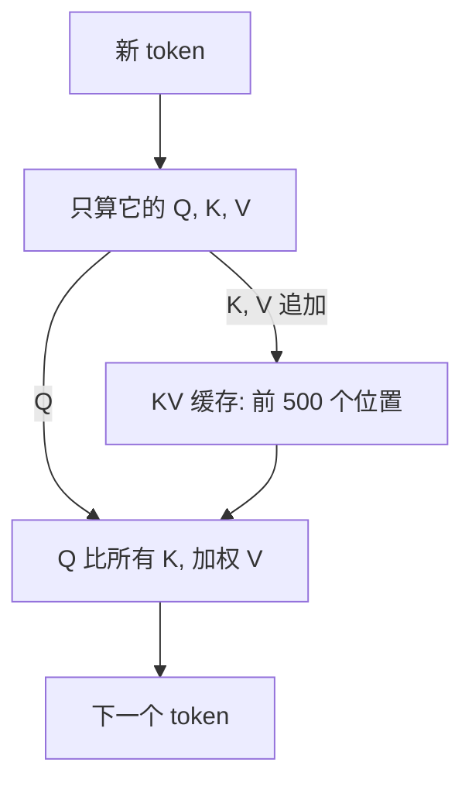

## Q
注意力的计算量为什么随文本长度增长？生成时为什么要把旧 token 的 K、V 存下来？以 7B 模型估算要存多少。

## A
**计算量随长度增长：** 注意力里每个位置都要和前面所有位置比较（Q 和每个 K 做点积）。
- 一次处理 n 个 token 的输入，比较次数约 n²/2。1,000 个 token 约 50 万次，10,000 个 token 约 5,000 万次，长度翻 10 倍，计算翻 100 倍。
- 生成阶段每次只新增 1 个 token，它要和前面所有 n 个位置比较，每步工作量随 n 线性增长。

**为什么存 K、V：** K（键）和 V（值）是每个位置从自己的隐藏状态乘参数矩阵算出来的。因为每个位置只能看前面，**旧位置的 K、V 永远不会变**。生成第 501 个 token 时，前 500 个位置的 K、V 和上一步完全相同。
- 不存：每生成一个 token 都要把前面所有 token 在所有层重算一遍，生成 n 个 token 总工作量约 n²。
- 存：每步只算新 token 自己的 Q、K、V，从缓存里读旧的 K、V。这份缓存叫 **KV 缓存（KV cache）**。

**以 7B 模型（32 层、每层 4,096 维、FP16 每数 2 字节、每个头都有自己的 K 和 V）估算：**
- 每 token 每层：K 和 V 各 4,096 个数 → 2 × 4,096 × 2 字节 = 16 KB。
- 每 token 全模型：16 KB × 32 层 = **512 KB**。
- 一个 4,096 token 的对话：512 KB × 4,096 = **2 GB**。
- 一张 80 GB 显卡放 14 GB 权重后剩约 60 GB，只够约 30 个这样的长对话同时进行。

**结论：** KV 缓存用内存换计算。它让生成每步的计算量很小，但每步要读的数据变多，而且同时能服务多少用户，常常先被这份缓存的大小卡住。

**新进展（2026 年 4 月）。** DeepSeek 发布开放权重（权重公开可下载）的 V4，窗口 100 万 token。在 100 万 token 时，V4-Pro 的 KV 缓存只有上一代 V3.2 的约 10%，V4-Flash 约 7%。办法是压缩存下的 K、V，再只挑相关位置来看，直接砍本卡那笔“每 token 512 KB”的账。

想一想：按本卡的算法，7B 模型存满 100 万 token 的 KV 缓存要多大？这说明长窗口首先卡在哪？
约 512 KB × 100 万 ≈ 512 GB，一张 80 GB 的卡连一个用户都装不下。所以长窗口先卡在显存而不是计算，压缩 KV 缓存是关键。

