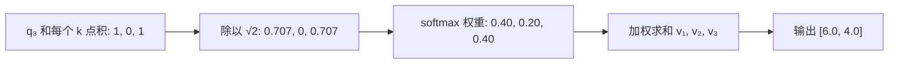

## Q
用一个 3 个 token、2 维向量的小例子，手算一次注意力（attention）：从 Q、K、V 到输出。

## A
**设定：** 当前处理第 3 个 token。Q（查询，当前位置"在找什么"）、K（键，每个位置的"标签"）、V（值，每个位置要贡献的内容）都已由参数矩阵算好：

- q₃ = `[1, 0]`
- k₁ = `[1, 0]`，k₂ = `[0, 1]`，k₃ = `[1, 1]`
- v₁ = `[10, 0]`，v₂ = `[0, 10]`，v₃ = `[5, 5]`

**第 1 步：打分。** q₃ 和每个 k 做点积：`[1, 0, 1]`。

**第 2 步：缩放。** 除以 √d（d 是向量维数，这里 √2 ≈ 1.414）：`[0.707, 0, 0.707]`。维数大时点积会很大，缩放防止下一步的概率过于极端。

**第 3 步：softmax 变成权重。** e^0.707 ≈ 2.028，e^0 = 1，总和 ≈ 5.056，权重 ≈ `[0.40, 0.20, 0.40]`，加起来为 1。

**第 4 步：加权求和 V。** 0.40×`[10, 0]` + 0.20×`[0, 10]` + 0.40×`[5, 5]` = `[6.0, 4.0]`。这就是第 3 个位置从上下文"取回"的信息。



公式合起来：`Attention(Q, K, V) = softmax(Q Kᵀ / √d) V`

```python
q = torch.tensor([[1., 0.]]); K = torch.tensor([[1., 0.], [0., 1.], [1., 1.]])
V = torch.tensor([[10., 0.], [0., 10.], [5., 5.]])
w = torch.softmax(q @ K.T / 2 ** 0.5, dim=-1)   # [[0.401, 0.198, 0.401]]
print(w @ V)                                    # [[6.01, 3.99]]
```

**真实模型里：** 向量是 128 维而不是 2 维，前文有几千个位置而不是 3 个，每层有 32 组这样的计算并行进行（称为多头注意力），但每一步的运算完全一样。
