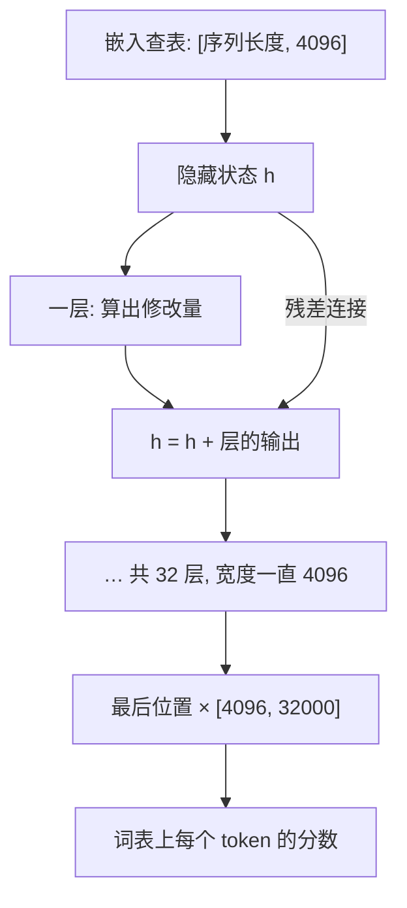

## Q
token 变成嵌入向量之后，这个向量在模型里经历了什么？为什么宽度一直保持不变？

## A
**隐藏状态（hidden state）：** 嵌入查表得到的向量进入模型后改叫隐藏状态。7B 模型里它始终是 4,096 个数。

**流程：**
1. 查嵌入表，得到每个 token 的初始向量 `[序列长度, 4096]`。
2. 依次经过 32 层。每一层读入隐藏状态，算出一个"修改量"，再**加回**原来的向量：`h = h + 层的输出`。这种"加回去"的连接叫残差连接（residual connection）。
3. 32 层之后，最后一个位置的隐藏状态乘以输出矩阵 `[4096, 32000]`，得到词表上每个 token 的分数。

**为什么宽度不变：** 因为每层都要做 `h + 层的输出`，两边形状必须一样。层内部可以临时变宽（比如中间扩到 11,008 再缩回来），出口一定回到 4,096。这让几十层可以像积木一样叠起来。

**一个有用的比喻：** 隐藏状态像一条贯穿全模型的"传送带"（也叫残差流，residual stream）。每层从传送带上读信息，把自己的贡献写回去。最初只有"这是哪个词"，越往后积累的上下文和语义越多。

**为什么残差连接重要：**
- 训练几十层的深网络时，信号和梯度可以沿着"加回去"的捷径直接传递，不会层层衰减。
- 对推理测试的意义：每层的输出是"原值 + 小修改"，所以逐层对比时，隐藏状态的差异会一层层累积。看到某层之后差异突然跳升，就能定位到那一层。

**输入输出共用一张表：** 有些模型让嵌入表和最后的输出矩阵共享同一份参数（weight tying），能省掉约 1.3 亿个参数；检查点转换时如果漏处理这一点，输出会完全错乱。
