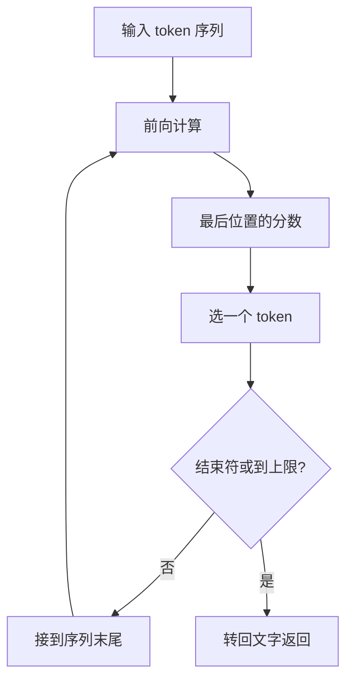

## Q
大模型是怎样一个字一个字生成回答的？讲清"自回归"（autoregressive）生成循环的每一步。

## A
**自回归：每一步的输出被接到输入末尾，作为下一步的输入。** 模型每次只能预测"下一个 token"（token 是文字切成的小片段），所以要写出一段话，就得反复调用。

**逐步走一遍：** 用户问 `"中国的首都是"`（假设切成 5 个 token）。
1. 5 个 token 一起送进模型，做一次前向计算（从第一层算到最后一层），得到最后一个位置对词表每个 token 的分数。
2. 选出分数最高的 `"北"`。
3. 序列变成 6 个 token，再做一次前向计算，选出 `"京"`。
4. 再一次，选出 `"。"`；再一次，选出结束标记（EOS，表示回答完毕），停止。

**关键事实：**
- **每生成 1 个 token 就要一次完整的前向计算。** 回答 500 个 token，就要跑 500 次模型，每次都要把全部参数读一遍。
- **步与步之间无法并行：** 第 3 步的输入依赖第 2 步的输出。
- **输入那 5 个 token 是一次并行处理的**，这一步叫预填充（prefill）；之后逐个生成的阶段叫解码（decode）。两者的性能特征完全不同。
- **流式输出：** 正因为是一个一个生成的，服务可以每出一个 token 就推给用户，不必等全部完成。
