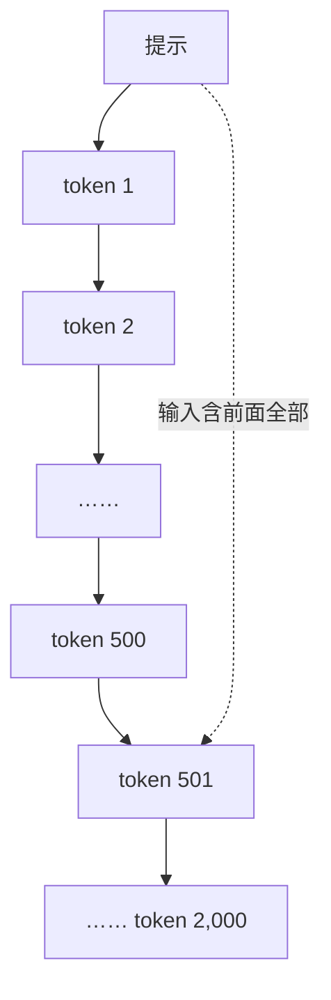

## Q
**挑战。** 用户嫌 2,000 token 的长回答要等 10 秒。同事提议："再加 3 张卡，4 张卡各生成 500 个 token，同时进行，2.5 秒就好。"为什么不行？真正能缩短这 10 秒的办法有哪些？

## A
**评分点（答出 3 条算过）：**

1. 自回归：第 n 个 token 的输入包含前面全部 n−1 个输出，第 501 个 token 在前 500 个写出来之前无法开始；一个回答内部不能并行。
2. 加卡提高的是同时服务的请求数（吞吐），不是单个回答的速度。
3. 让每一步更快：更小的模型或压缩过的参数，带宽更高的硬件。
4. 让步数更少或体感更快：限制输出长度；流式输出，边生成边显示；把任务拆成互相独立的几个小问题，各自作为独立请求并行。
5. 加分：一步猜多个 token 的技术，例如推测解码（小模型先猜几个，大模型一次检验）。

参考答案
不行，因为生成是自回归的：每个新 token 都要以前面所有已生成的 token 为输入，第 501 个 token 必须等前 500 个写完，一个回答内部没法切成四段同时生成。加卡只能让更多请求同时被服务。要缩短这 10 秒，可以让每一步更快，比如用更小或压缩过的模型和带宽更高的硬件；也可以减少步数或改善体感，比如限制输出长度、流式显示，或者把任务拆成彼此独立的几个请求并行处理。

