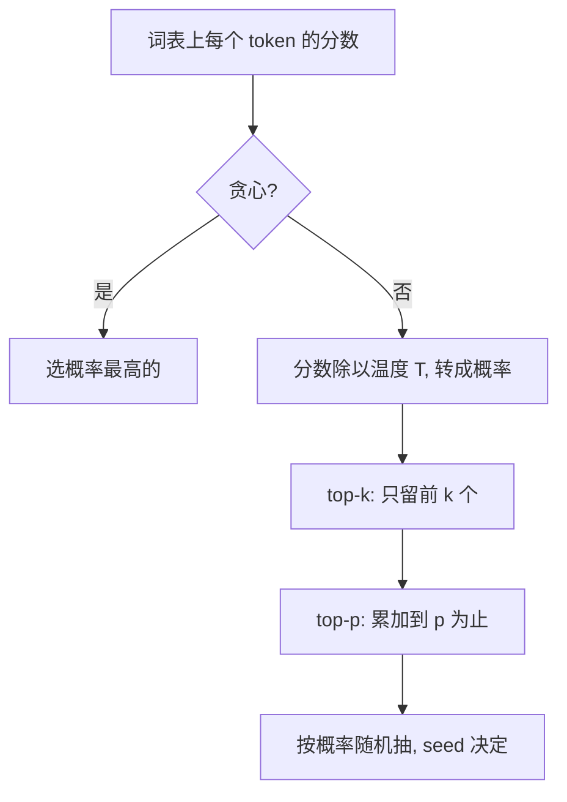

## Q
从下一个 token 的概率里"选一个"有哪几种方法？贪心（greedy）和采样（sampling）各有什么用，对测试有什么影响？

## A
模型每一步给出词表上每个 token 的概率，选法决定输出的风格和可复现性。

- **贪心解码（greedy）：** 永远选概率最高的那个。确定性强，同一输入（理论上）总得到同一输出。缺点是容易陷入重复（"我认为我认为我认为…"），创作类任务显得呆板。
- **温度采样（temperature sampling）：** 先把分数（logits）都除以温度 T，再转成概率，然后按概率随机抽一个。T < 1 让高分更突出（更保守），T > 1 让分布更平（更有创意），T → 0 等价于贪心。
- **top-k：** 只在概率最高的 k 个里抽，比如 k = 50。
- **top-p（核采样，nucleus sampling）：** 按概率从高到低累加，加到 p（如 0.9）为止，只在这些候选里抽。候选数随分布自动变化。
- **随机种子（seed）：** 采样用的随机数由种子决定，固定种子理论上能复现同一结果。

**对测试的影响：**
- **功能和数值回归测试用贪心或 `temperature=0`：** 这样输出只取决于模型计算本身，新旧版本应给出相同文字。
- **但贪心也不保证逐字相同：** 两个候选分数非常接近时，计算顺序带来的微小数值差异（不同批大小、不同硬件）就可能让选择翻转，之后的文字全部不同。所以比较时要容忍"在接近平局处分叉"，或直接比较概率。
- **采样参数本身也要测：** `temperature`、`top_p`、`seed` 是否真的生效，可以用统计检验：同一请求跑 1000 次，看各候选出现的频率是否符合设定的概率。
