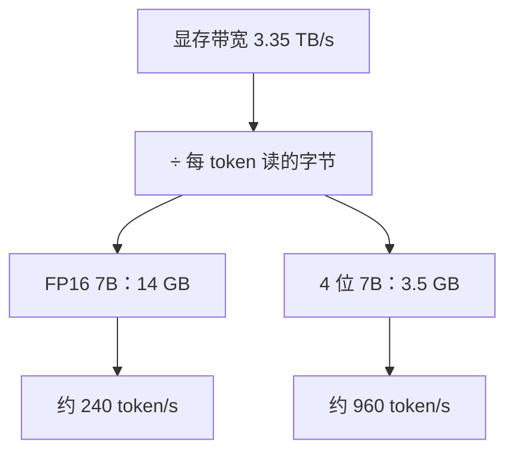

## Q
给你一块显卡的显存带宽和一个模型的大小，怎样一步估算"单用户每秒最多生成多少 token"？这个估算在什么情况下不准？

## A
**估算公式：** 单用户生成速度上限 ≈ **显存带宽 ÷ 每个 token 要读的字节数**，而每个 token 至少要把全部参数读一遍。

**手算几个例子（FP16，每参数 2 字节）：**
- 7B 模型（14 GB）在 H100（3.35 TB/s）上：3350 ÷ 14 ≈ **240 token/s**。
- 7B 模型在 A100 80GB（约 2.0 TB/s）上：约 140 token/s。
- 70B 模型（140 GB）放不进一张 80 GB 的卡，至少要 2 张；用 8 张 H100 平分参数，总带宽 26.8 TB/s：26800 ÷ 140 ≈ **190 token/s**。
- 同一个 7B 模型压缩成每参数 4 位（0.5 字节，3.5 GB），上限翻 4 倍，约 960 token/s。这就是"量化"（quantization，用更少的位数存参数）能提速的根本原因。

**这个估算在哪些情况下不准：**
- **实际带宽打折：** 很难跑到峰值，通常只能达到 60%–80%；多卡分工时还要互相通信，8 卡做单用户生成时，实测带宽利用率可能只有约 25%。
- **还要读别的数据：** 每个请求保存的历史中间结果（称为 KV 缓存：每个已处理 token 在每一层的键、值向量）也要读，长对话时这部分可以和参数一样大。
- **批量大时：** 多个请求共享一次参数读取，总吞吐远高于这个数，但单个用户的速度不会更快。
- **算力受限时：** 输入很长的那一步（一次处理几千个 token）由算力决定，不由带宽决定。

这个"带宽 ÷ 模型大小"的估算，是判断一个推理系统的实测速度合不合理的第一把尺子：实测远低于它，说明有别的开销；实测高于它，说明测量方法有问题，或者系统用了某种技巧（比如一次猜多个 token）。
