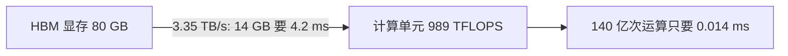

## Q
"算力"（FLOPS）和"内存带宽"（memory bandwidth）分别衡量什么？为什么说一块 AI 芯片往往是"算得快、搬得慢"？

## A
**两个指标衡量两件不同的事：**
- **算力（FLOPS，每秒浮点运算次数）：** 计算单元每秒能做多少次乘加。H100 的 BF16 稠密峰值约 989 TFLOPS，即每秒约 989 万亿次。
- **内存带宽（GB/s 或 TB/s）：** 每秒能从内存搬多少字节到计算单元。H100 的 HBM 带宽约 **3.35 TB/s**。HBM（High Bandwidth Memory，高带宽内存）是叠在芯片旁边的显存，比普通内存快得多，H100 配 80 GB。

**两者一比：** 989 万亿次 ÷ 3.35 万亿字节 ≈ **295**。也就是说，芯片每搬进 1 字节数据，有能力做约 295 次运算。如果一段计算每字节只做 1 次运算，计算单元 99% 的时间在等数据。

**用 7B 模型生成一个 token 算一遍：**
- 要做的运算：约 140 亿次。按 989 TFLOPS，只需 **0.014 毫秒**。
- 要搬的数据：所有参数读一遍，14 GB。按 3.35 TB/s，需要 **4.2 毫秒**。
- 搬运时间是计算时间的 300 倍。所以单个请求时，每秒最多生成约 1000 ÷ 4.2 ≈ **240 个 token**，再快不了，无论算力多强。

**结论：** 单个用户生成文字时，速度由**内存带宽**决定，不由算力决定，这叫"带宽受限"（memory-bandwidth-bound）。反过来，一次处理很多 token（长输入、大批量）时，每搬一次数据能做很多运算，速度才由算力决定，叫"算力受限"（compute-bound）。几乎所有推理优化都在处理这两种状态。
