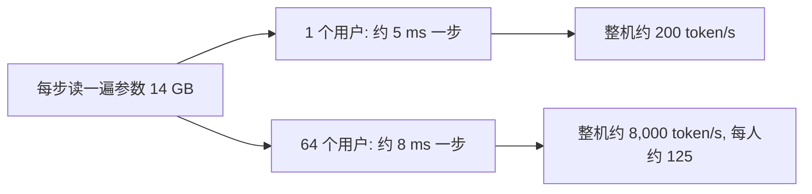

## Q
推理服务为什么一定要把多个用户的请求"凑成一批"（batching）一起算？凑批的代价是什么？

## A
**原因：生成阶段，一块芯片的大部分算力在等数据。**
- 生成每个 token 都要把全部参数从显存读一遍。7B 模型 14 GB，在 H100（显存带宽约 3.35 TB/s）上约 4.2 毫秒。
- 这一步真正的计算只需约 0.014 毫秒，算力利用率不到 1%。
- 如果 64 个用户一起算，参数还是只读一遍，64 个用户各得到 1 个 token。每步时间增加不多，总吞吐接近 64 倍。

**手算：**
- 1 个用户：约 5 毫秒一步，整机每秒约 200 个 token。
- 64 个用户：假设每步约 8 毫秒，整机每秒 64 ÷ 0.008 = **8,000 个 token**，每个用户每秒约 125 个，体验仍然流畅。

**凑批的代价：**
- **单用户变慢：** 批越大，每一步越久，每个人的 token 间隔变长。批大到计算本身成为瓶颈后，再加人就只是让每个人更慢。
- **内存：** 每个用户的对话历史中间结果（KV 缓存）都要占显存。7B 模型每个 token 约 512 KB，64 个用户各 2,000 token 就是 64 GB，比权重还大。批的上限往往是内存而不是算力。
- **等待：** 传统做法是凑齐一批再一起开始、一起结束，短回答要陪长回答等，新请求要等整批结束。现代引擎改为"连续批处理"（continuous batching）：每一步都可以让完成的请求离开、新请求加入。
- **相互干扰：** 一个超长输入的处理会让同批其他人的下一个字暂停。

**一句话：** 批处理是用"每个人稍慢一点"换"整机多服务很多人"，服务配置的核心就是在延迟目标内把批做大。
