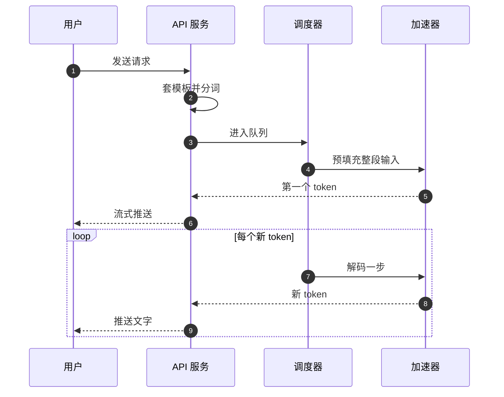

## Q
用户在聊天应用里发出一个问题，到看到回答一个字一个字地出现，推理服务内部经历了哪些步骤？

## A

1. **接收请求：** API 服务（通常兼容 OpenAI 的接口格式）校验参数、鉴权、限流。
2. **预处理：** 用对话模板把消息拼成文本，再用分词器转成 token 编号（token 是文字切成的小片段）。
3. **排队与调度：** 调度器决定这个请求什么时候上加速器（GPU 或其他 AI 芯片），和哪些请求凑成一批，给它分配存放中间结果（KV 缓存）的内存。
4. **预填充（prefill）：** 整段输入一次前向计算，生成每层的 K、V 存入缓存，并得到第一个输出 token。
5. **解码（decode）：** 每一步为批里每个请求各生成 1 个 token，追加到缓存。新请求可以随时加入，完成的随时离开。
6. **后处理与流式返回：** 把 token 转回文字（注意多字节字符要攒完整），检查停止条件，通过 SSE（服务器推送事件，一种 HTTP 流式响应格式）推给用户。
7. **结束：** 返回用量统计（输入、输出各多少 token），释放缓存。

**推理服务的三个目标：** 快（延迟低）、省（每张卡服务更多 token）、对（输出和参考实现一致、不丢不乱）。几乎所有工程工作和测试都围绕这三点。
