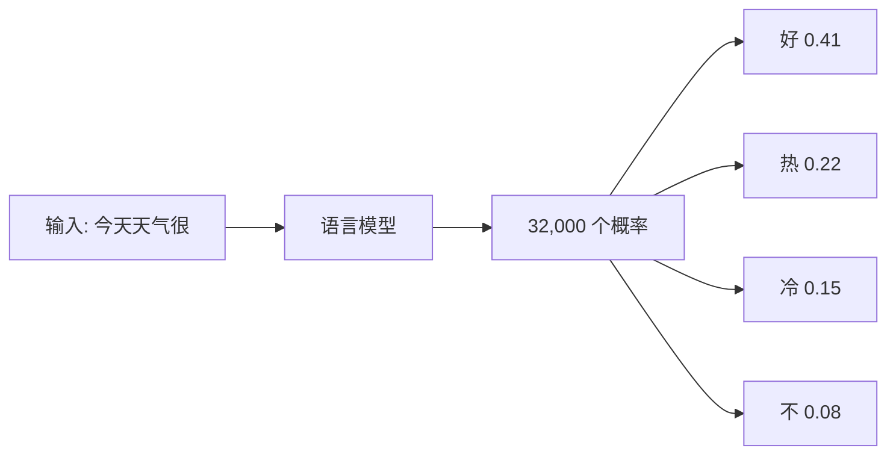

## Q
"语言模型"（language model）到底在做什么？用一个具体例子说明它的输入和输出。

## A
**语言模型只做一件事：给定前面一段文字，算出"下一个 token 是词表里每一个 token"的概率。** token 是文字被切成的小片段，每个对应一个编号；词表是所有 token 的列表。

**例子。** 输入 `"今天天气很"`，模型输出一个长度等于词表大小（比如 32,000）的概率列表，大部分接近 0，排在前面的可能是：

| 下一个 token | 概率 |
|---|---|
| 好 | 0.41 |
| 热 | 0.22 |
| 冷 | 0.15 |
| 不 | 0.08 |
| …其余 31,996 个 | 合计 0.14 |

**它是怎么学会的：** 训练时拿海量文字，每个位置都让模型猜下一个 token，猜错就调整参数（参数是模型里几十亿个可调的数字）。见过足够多的文字后，它学到了语法、事实、推理的模式，因为"猜对下一个字"需要这些知识。

**为什么这一件事就够用：** 只要能预测下一个 token，就能一个一个地接着写，生成完整的句子、代码、回答。对话、翻译、写代码都只是"续写"的不同形式。

**对工程的含义：**
- 模型本身**不输出文字，只输出概率**。从概率里挑哪个 token、何时停止，是推理服务的工作。
- 同一个模型、同一个输入，概率列表是确定的；输出文字可以不同，是因为挑选时可能加了随机性。
- 测试时最精确的比较对象是这份概率（或它之前的原始分数），而不是最终文字。
