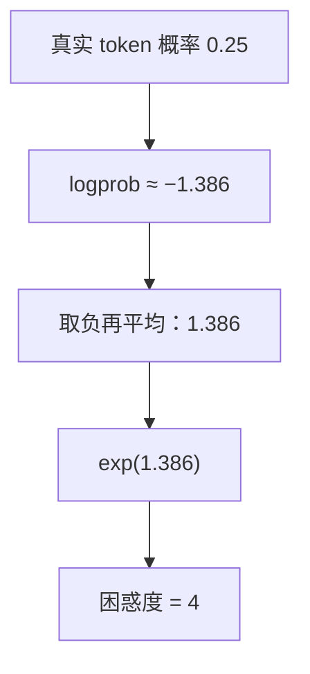

## Q
怎样用一个数字衡量语言模型"预测得好不好"？困惑度（perplexity）和对数概率（logprob）是什么，测试推理系统时怎么用？

## A
**对数概率（logprob）：** 模型给"真实出现的那个 token"的概率取自然对数。概率 0.5 → logprob ≈ −0.69；概率 0.01 → ≈ −4.6。取对数是因为一串 token 的总概率是连乘，很快小到浮点数表示不了，取对数后连乘变成相加。

**平均负对数概率（交叉熵，cross-entropy loss）：** 对一段文字的每个位置，取模型给真实下一个 token 的 logprob，取负再平均。训练时最小化的就是它。

**困惑度（perplexity）：** `exp(平均负对数概率)`。直观含义是"模型每一步平均在几个候选里犹豫"。
- 每个真实 token 都被给出 0.25 的概率 → 平均负 logprob = 1.386 → 困惑度 = **4**。
- 好的大模型在普通英文上困惑度常在个位数；随机乱猜 32,000 个 token，困惑度就是 32,000。

**测试推理系统时的用法：**
- **同一模型、同一文本，困惑度应几乎不变。** 换了推理引擎、改了数值精度、升级了驱动，在一份固定文本（例如 WikiText-2）上算困惑度，和基线相比上升超过约 1% 就要查。
- **API 的 `logprobs` 字段：** OpenAI 兼容接口可以返回每个生成 token 的 logprob 和前几名候选。用它比新旧版本，比只比文字灵敏得多。
- **局限：** 困惑度对一些退化不敏感，比如压缩参数（量化）后长推理任务变差，困惑度可能只升一点点。所以它是快速冒烟检查，正式验证还要跑带标准答案的评测集。
