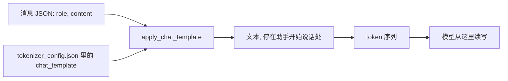

## Q
什么是对话模板（chat template）？为什么推理服务拼错模板是一个严重但难发现的缺陷？

## A
**对话模板：把一组结构化消息拼成模型训练时见过的那种文本格式的规则。** 模型只认一串 token，不认识 JSON 里的 `role`、`content`。服务收到：

```json
[{"role": "system", "content": "你是助手"}, {"role": "user", "content": "你好"}]
```

必须按模型对应的模板拼成文本。Llama 3 的格式大致是：

```python
prompt = (
    "<|begin_of_text|><|start_header_id|>system<|end_header_id|>\n\n"
    "你是助手<|eot_id|><|start_header_id|>user<|end_header_id|>\n\n"
    "你好<|eot_id|><|start_header_id|>assistant<|end_header_id|>\n\n"
)
```

最后停在"助手开始说话"的位置，模型从这里续写。不同模型家族的模板完全不同（标记、换行、系统提示放哪里都不一样）。

**模板放在哪：** Hugging Face 模型目录的 `tokenizer_config.json` 里有 `chat_template` 字段，是一段 Jinja 模板。代码里用 `tok.apply_chat_template(messages, add_generation_prompt=True)` 生成文本。



**为什么拼错很危险：**
- **不报错：** 模型对任何 token 序列都能算出输出，只是质量变差。
- **退化是隐蔽的：** 简单问题照样答对，复杂指令、多轮对话、工具调用的成功率下降几个到几十个百分点。
- **常见错误：** 漏了最后的"助手开始"标记；多加了一个开始标记（分词器自动加了一次，模板里又有一次）；换行数不对；系统提示被忽略；工具调用的格式和模型训练时不一致。

**测试方法：** 对每个模型，把服务实际送进模型的 token 序列（大多数引擎可以打日志）和 `apply_chat_template` 的参考结果逐 token 比较；覆盖单轮、多轮、带系统提示、带工具调用四类场景。
