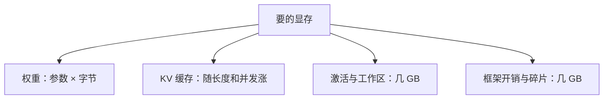

## Q
7B、13B、70B 这些数字是什么意思？怎样快速估算一个模型需要多少显存、几张卡？

## A
**数字就是参数个数**（B = billion，十亿）。7B 约 70 亿个参数。参数是模型里训练好的数字，推理时全部要放在加速器（GPU 等）的内存里。

**估算：权重显存 = 参数个数 × 每个参数的字节数。**

| 模型 | FP16 / BF16（2 字节） | 8 位（1 字节） | 4 位（0.5 字节） |
|---|---|---|---|
| 7B | 14 GB | 7 GB | 3.5 GB |
| 13B | 26 GB | 13 GB | 6.5 GB |
| 70B | 140 GB | 70 GB | 35 GB |
| 405B | 810 GB | 405 GB | 约 203 GB |

FP16、BF16 是 16 位浮点数；8 位、4 位是压缩后的格式（量化，quantization），用精度换空间。

**但权重不是全部。** 还要留给：
- **KV 缓存：** 每个请求的历史中间结果，随对话长度和并发数增长，常常和权重一样大甚至更大；
- **激活与工作区：** 计算过程中的临时数据，几 GB；
- **框架开销与碎片：** 几 GB。

**例子：** 70B 模型 FP16 部署在 80 GB 的卡上。140 GB 权重至少要 2 张卡；实际常用 4 或 8 张，把剩下的显存留给 KV 缓存，才能同时服务足够多的用户。

**还有一种模型叫混合专家（MoE，mixture of experts）：** 每层有很多组前馈网络（"专家"），每个 token 只用其中几组。参数总量和每个 token 实际用到的参数量不同，比如"总参数 1200 亿、激活参数 50 亿"。**显存按总参数算，每 token 计算量按激活参数算**，估算时不能混用。
