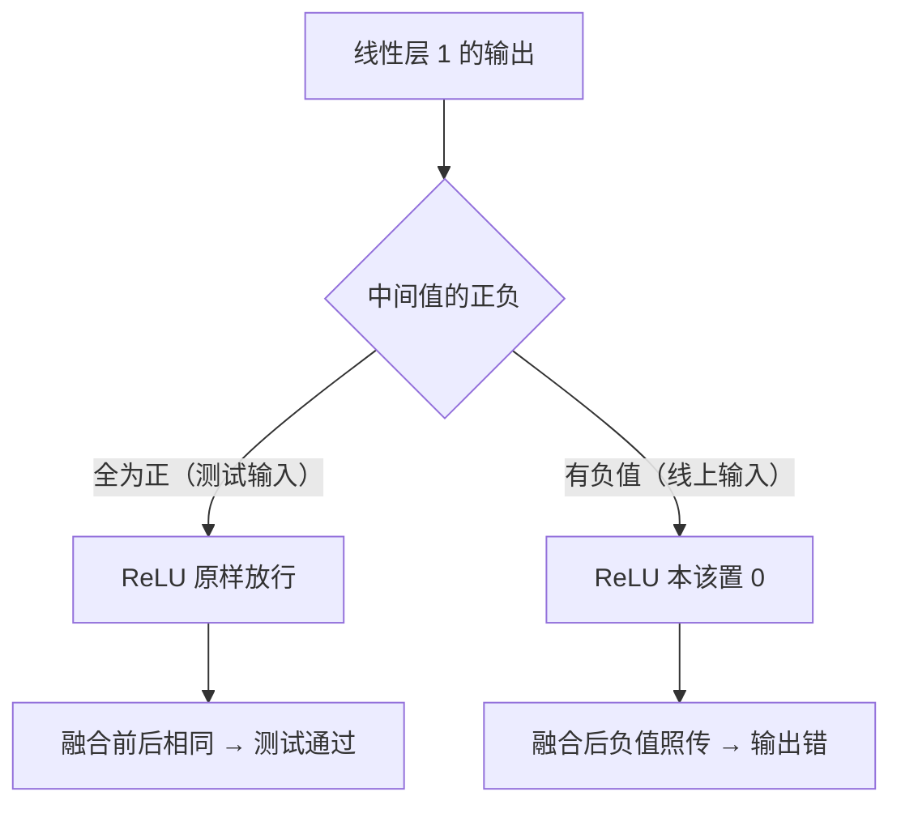

## Q
**挑战。** 推理引擎的图优化把"线性层 → ReLU → 线性层"融合成了一个线性层（两个矩阵提前乘在一起），省掉一次矩阵乘法。单元测试全过，线上精度却大跌。后来发现：测试用的输入经过第一层后全是正数。为什么测试会过？融合错在哪？测试怎么补？

## A
**评分点（答出 3 条算过）：**

1. 两个线性层之间没有激活函数时，确实可以合并成一个矩阵，结果完全相同；中间有激活就不行。
2. ReLU 对正数原样放行：测试输入在这里全为正，ReLU 等于不存在，融合前后输出相同，所以测试通过。
3. 线上输入有负值，ReLU 本该把它们变成 0，融合后负值照常传下去，输出就错了；两层退化成一层线性变换，表达能力丢了。
4. 补测试：输入要落在激活函数的两侧（正和负），用大量随机输入比较优化前后的输出，差值超过阈值就失败。
5. 一般规则：图优化的每条改写都要有等价性测试，输入要让每个分支都起作用。

参考答案
两个线性层直接相连时可以合并成一个矩阵，但中间隔着 ReLU 就不行，因为 ReLU 会把负数变成 0，这一步不是线性的。测试之所以通过，是因为测试输入经过第一层后全是正数，ReLU 对正数什么也不做，融合前后的结果碰巧相同。线上输入会产生负值，融合后的网络没有把它们置零，输出就错了，而且两层变成了一层线性变换。测试要用覆盖正负两侧的随机输入，比较优化前后的输出是否在误差阈值内。

