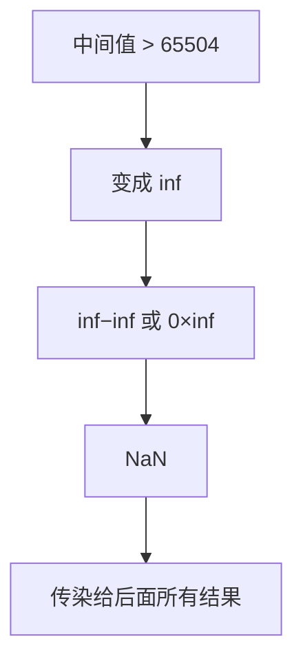

## Q
一个神经网络在 FP32 下输出正常，换成 FP16 后输出变成 NaN（不是数字）。可能是什么原因？怎么排查？

## A
**背景。** FP32 是 32 位浮点数，FP16 是 16 位浮点数，每个数占的字节减半、计算更快，但**能表示的范围和精度都小得多**：

- FP16 最大只能表示 **65504**，超过就变成无穷大（inf）；
- FP16 只有约 3 位有效十进制数字，很小的数（约 6×10⁻⁸ 以下）直接变成 0；
- inf 再参与运算，比如 inf − inf 或 0 × inf，就得到 NaN，然后 NaN 会传染给后面所有结果。

**常见原因：**

- **中间值太大：** 某层矩阵乘法的累加和超过 65504，例如 4096 个数相乘再相加，每项 20 左右就可能溢出。
- **指数运算：** 把分数变成概率的 softmax 函数要算 e^x，x = 12 时 e^x ≈ 16 万，FP16 已经溢出。正确实现会先减去最大值再算。
- **归一化里除以很小的数。**

**排查步骤：**

1. 用 PyTorch 前向钩子（`register_forward_hook`）记录每层输出的 `max().abs()` 和 `isnan().any()`，找到第一个出现 inf 的层。
2. 把那一层单独用 FP32 跑，对比结果确认。
3. 修复方向：改用 **BF16**（16 位但指数位和 FP32 一样多，最大约 3.4×10³⁸，几乎不溢出，代价是精度更低），或让累加在 FP32 里做。

这也是大模型训练和推理普遍用 BF16 而不是 FP16 的原因。
