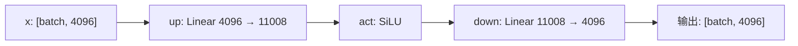

## Q
什么是前向计算（forward pass）？用几行 PyTorch 写一个两层网络，标出每一步的形状和参数数量。

## A
**前向计算**就是把输入从第一层依次算到最后一层，得到输出。推理只做这一件事。

```python
import torch
from torch import nn

class TinyMLP(nn.Module):
    def __init__(self):
        super().__init__()
        self.up = nn.Linear(4096, 11008)    # 参数 4096*11008 + 11008 ≈ 4510 万
        self.act = nn.SiLU()                # 激活函数，无参数
        self.down = nn.Linear(11008, 4096)  # 参数 ≈ 4509 万

    def forward(self, x):                   # x: [batch, 4096]
        h = self.act(self.up(x))            # h: [batch, 11008]
        return self.down(h)                 # 输出: [batch, 4096]

m = TinyMLP()
print(sum(p.numel() for p in m.parameters()))   # 约 9019 万
y = m(torch.randn(8, 4096))                     # 8 个输入一起算
```



逐行说明：

- **`nn.Linear(4096, 11008)`：** 一个"全连接层"，内部是形状 `[11008, 4096]` 的权重矩阵加长度 11008 的偏置。
- **先变宽再变窄：** 4096 → 11008 → 4096。中间变宽让网络有更多"神经元"表达特征，最后回到原宽度，方便一层层叠下去。这正是大模型每层里"前馈网络"的形状（以 7B 级别模型为例）。
- **`forward` 就是前向计算：** 调用 `m(x)` 时 PyTorch 执行它。
- **`batch` 维度：** 一次喂 8 个输入，形状 `[8, 4096]`，参数只用一份。

7B 模型就是把类似的结构（再加注意力部分）重复 32 次，参数累加到约 70 亿。
