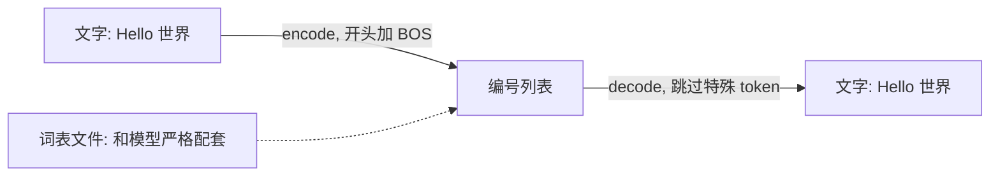

## Q
写一段代码把文字变成 token 编号再变回来。分词器（tokenizer）往返转换时有哪些坑？

## A
```python
from transformers import AutoTokenizer
tok = AutoTokenizer.from_pretrained("meta-llama/Llama-2-7b-hf")

ids = tok.encode("Hello 世界")         # 文字 → 编号列表，默认在开头加 BOS
print(ids)                            # 开头的 1 是 <s>，后面是正文的编号
print(tok.convert_ids_to_tokens(ids)) # 看每个编号对应的片段
text = tok.decode(ids, skip_special_tokens=True)
assert text == "Hello 世界"
```

**分词器是什么：** 一个独立于模型的程序加一份词表文件，负责"文字 ↔ 编号"互转。它和模型参数必须严格配套：模型学到的是"某个固定编号代表 Hello"，换一个分词器，同一个编号就代表别的字。



**往返转换的坑：**
- **特殊 token：** `encode` 默认在开头加"开始标记"（BOS，beginning of sequence）。忘了它或加了两次，模型输出质量会下降，但不会报错。
- **空格：** 很多分词器把空格并进后一个 token（`" world"` 而不是 `"world"`）。单独解码一个 token 再拼接，空格可能丢失或多出。
- **多字节字符：** 一个汉字可能被拆成 3 个字节 token。逐个 token 解码时，前两个字节单独解码是乱码（显示成 `�`），必须攒够完整字符再输出。流式返回文字时这是常见 bug。
- **规范化：** 有些分词器会改写全角半角、Unicode 组合字符，导致 `decode(encode(x)) != x`。

**测试建议：** 准备一组含中英文、emoji、代码、连续空格、罕见字的样本，断言往返一致；分词器文件做哈希校验，和模型版本一起发布。
