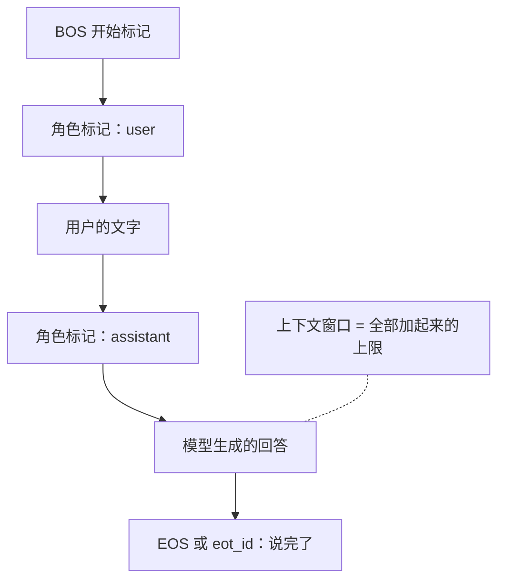

## Q
什么是特殊 token（special token）和上下文窗口（context window）？它们在推理服务里分别会引出什么问题？

## A
**特殊 token：词表里不代表普通文字的"控制符号"。**
- **开始标记（BOS）：** 放在输入最前面，告诉模型"一段新文字开始了"。Llama 2 里是 `<s>`，编号 1。
- **结束标记（EOS，end of sequence）：** 模型生成它，表示"我说完了"。Llama 2 里是 `</s>`，编号 2；Llama 3 的对话模型用 `<|eot_id|>` 表示一轮回答结束。
- **角色标记：** 对话模型用特殊 token 区分系统指令、用户、助手，比如 `<|start_header_id|>user<|end_header_id|>`。
- **填充（pad）：** 把不同长度的输入补齐成一样长时用。

**上下文窗口：模型一次能处理的最大 token 数**，包括输入和已经生成的输出。Llama 2 是 4,096，Llama 3.1 是 128K（约 13 万）。它由训练方式和位置编码决定，不是随便调大的设置。

**在推理服务里引出的问题：**
- **结束标记配错：** 服务只认 `</s>`，而模型实际输出 `<|eot_id|>`，结果模型说完了不停，一直生成到长度上限。这是新模型上线最常见的缺陷之一。
- **超出窗口：** 输入加输出超过上限时，服务必须选择：报错、截断最早的内容，还是限制输出长度。不同选择要在接口文档里写清，测试要覆盖"恰好等于上限"和"超出 1"两个边界。
- **长度按 token 算：** 用户说"我只发了 1 万个字"，可中文可能是 1 万到 3 万个 token。限流、计费、超限判断都必须用和模型同一个分词器计数。

**新进展（2026 年 3 月）。** Anthropic 宣布 Claude Opus 4.6 和 Sonnet 4.6 的 100 万 token 窗口正式可用，整段按标准价计费，没有长上下文加价；而 Gemini 3.1 Pro 超过 20 万、GPT-5.4 超过 27.2 万 token 就要加价。

想一想：按上面的说法，100 万 token 大约能装多少汉字？
上面说 1 万字约 1–3 万 token，所以 100 万 token 约合 33 万–100 万字。输入和输出共用这扇窗，要给输出留位置。

