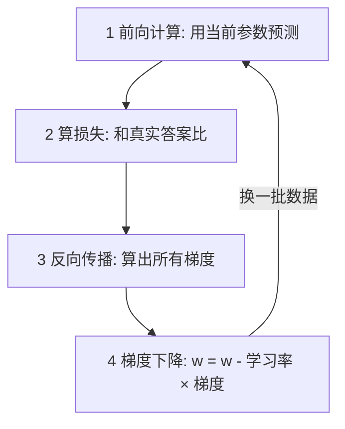

## Q
模型的参数是怎么"训练"出来的？用最直白的话讲清损失函数（loss）、梯度（gradient）、反向传播（backpropagation）和梯度下降（gradient descent）。

## A
用房价模型 `price = w * area + b` 举例，训练就是反复执行四步：

1. **前向计算：** 用当前参数（一开始是随机数，比如 `w = 1, b = 0`）预测一套 100 平米的房子，得到 100 万。
2. **算损失：** 损失函数衡量"错得多离谱"。真实价格 370 万，用平方误差 `(100 - 370)² = 72900`。损失越小越好。
3. **算梯度：** 梯度回答"每个参数往哪个方向、调多少，损失下降最快"。这里损失对 `w` 的导数是 `2 × (预测 - 真实) × area = 2 × (-270) × 100 = -54000`，负号表示 `w` 应该变大。大模型有几十亿个参数，逐个求导不现实，**反向传播**就是从输出往输入逐层用链式法则一次算出所有参数的梯度，计算量约为前向计算的 2 倍。
4. **更新参数（梯度下降）：** `w = w - 学习率 × 梯度`。学习率取 0.00001，`w` 从 1 变成 1.54。然后换一批数据，回到第 1 步。

重复几百万次之后，参数稳定在让损失很小的位置，训练结束。

大语言模型的训练完全一样，只是"输入"是一段文字，"正确答案"是这段文字的下一个字，参数有几十亿个，数据有几万亿个字。

和推理的关系：**训练 = 前向 + 反向 + 更新，参数一直在变；推理 = 只有前向，参数冻结。** 推理服务里永远不会出现反向传播。
