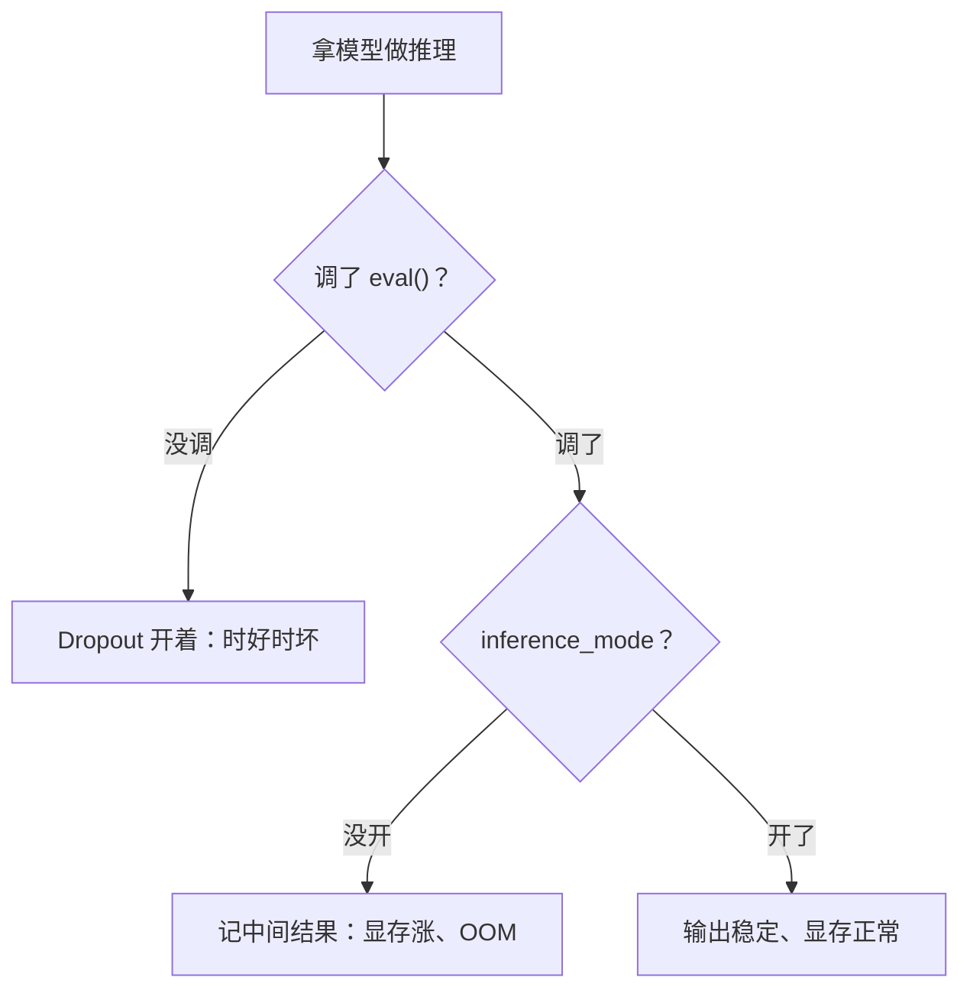

## Q
在 PyTorch 里拿训练好的模型做推理，为什么必须调用 `model.eval()` 和 `torch.inference_mode()`？忘了会出什么问题？

## A
训练和推理用的是同一份代码，但有两类行为必须切换。

**`model.eval()`：切换层的行为。**
- 有些层在训练和推理时算法不同。最典型的是 Dropout：训练时随机把一部分数字置 0，防止模型死记硬背；推理时必须关掉。
- 忘了 `eval()`：同一个输入每次输出都不一样，而且质量变差。测试表现为"偶发不一致"，很像并发 bug，容易查错方向。
- `model.training` 属性可以检查当前状态。

**`torch.inference_mode()`（或较老的 `torch.no_grad()`）：关掉梯度记录。**
- 训练时 PyTorch 会把每一层的中间结果记下来，留给反向传播算梯度用。推理不需要反向传播，这些记录纯属浪费。
- 忘了关：显存占用明显上升，长输入或大批量时会内存不足（OOM，out of memory），速度也更慢。
- `inference_mode` 比 `no_grad` 更彻底，连张量的版本计数都不维护，开销更小。

```python
model.eval()
with torch.inference_mode():
    logits = model(input_ids).logits
```



**测试建议：**
- 同一输入连续跑两次，输出逐位相同（在关闭随机采样的前提下），能抓住漏掉 `eval()`。
- 记录峰值显存 `torch.cuda.max_memory_allocated()`，和基线比，能抓住漏掉 `inference_mode()`。

专用推理引擎（如 vLLM）内部已经处理好这两点，但自写的参考实现和测试脚本里常常漏掉。
