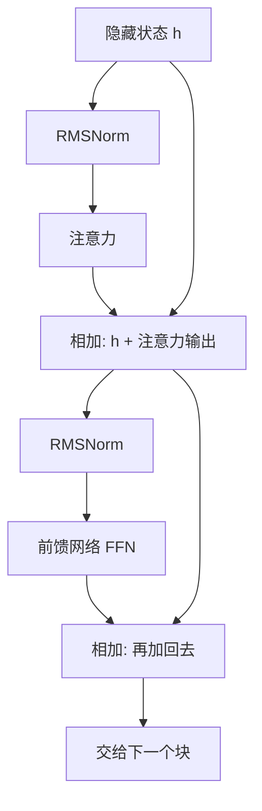

## Q
一个 Transformer 块（block，也叫一层）由哪几部分组成？数据按什么顺序流过？

## A
Transformer 是今天几乎所有大语言模型采用的结构。模型 = 嵌入查表 + N 个结构完全相同的块 + 输出层。7B 模型有 32 个块。

**一个块里的四个部件（以 Llama 这类现代模型为例）：**
- **归一化（normalization，常用 RMSNorm）：** 把向量的整体大小调到稳定范围，防止数值越滚越大或越来越小。它有少量参数（每层 4,096 个）。
- **注意力（attention）：** 每个位置去看前面所有位置，按相关程度汇总信息。负责"词与词之间的关系"。
- **前馈网络（FFN，feed-forward network，也叫 MLP）：** 对每个位置单独做"变宽—激活—变窄"的计算，不和其他位置交流。负责"对每个词的信息做加工"，模型记住的大量知识被认为主要存放在这里。
- **残差连接（residual connection）：** 每个子部件的输出**加回**它的输入，而不是替换。

**一句话：** 先归一化再算注意力、加回去；再归一化再算前馈、加回去。这叫"前置归一化"（pre-norm），是现代大模型的标准做法。

**注意两种部件的分工：** 注意力是唯一让不同位置互相交流的地方；前馈网络和归一化都是每个位置独立计算。这一点决定了后面很多优化：前馈网络可以把很多位置堆成一个大矩阵一起算，注意力则要专门处理每个请求各自的历史。
