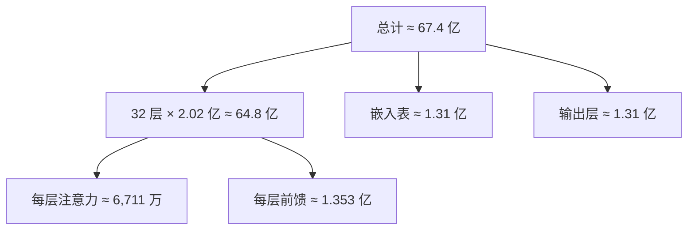

## Q
"7B" 的 70 亿个参数分布在哪里？按 Llama 2 7B 的结构手算一遍。

## A
**结构参数：** 32 层，隐藏宽度 d = 4,096，前馈网络中间宽度 11,008，词表 32,000。

**每一层：**
- **注意力：** 查询、键、值、输出 4 个矩阵，各 `[4096, 4096]`：4 × 4,096² ≈ **6,711 万**。
- **前馈网络：** Llama 用 SwiGLU 结构，有 3 个矩阵（两个"变宽"，一个"变窄"），各 `[4096, 11008]`：3 × 4,096 × 11,008 ≈ **1.353 亿**。SwiGLU 是一种带门控的激活方式：一个变宽的结果过激活函数后，逐元素乘上另一个变宽的结果。
- **归一化：** 2 × 4,096，可忽略。
- **每层合计约 2.02 亿**，其中前馈约占 2/3。

**全模型：**
- 32 层 × 2.02 亿 ≈ **64.8 亿**
- 嵌入表 `[32000, 4096]` ≈ **1.31 亿**
- 输出层 `[4096, 32000]` ≈ **1.31 亿**
- 总计 ≈ **67.4 亿**，官方报告 6.74B，四舍五入叫"7B"。



**由此得到的直觉：**
- **参数几乎全在矩阵乘法里：** 所以"每个 token 计算量 ≈ 2 × 参数量"这个估算很准。
- **前馈网络是大头：** 压缩或切分参数时，前馈层的影响最大。
- **一层的大小：** 约 2 亿参数，FP16 约 0.4 GB。模型分到多块芯片时常按层切，"一层多大"决定一块芯片放几层。

```python
from transformers import AutoConfig
c = AutoConfig.from_pretrained("meta-llama/Llama-2-7b-hf")
print(c.num_hidden_layers, c.hidden_size, c.intermediate_size, c.vocab_size)
# 32 4096 11008 32000
```
