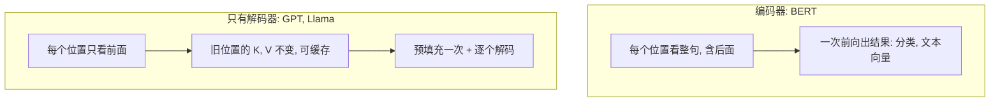

## Q
"只有解码器"（decoder-only）的模型（如 GPT、Llama）和"编码器"（encoder）模型（如 BERT）有什么区别？为什么生成式大模型都选前者？

## A
**两者都由 Transformer 块堆成，区别在注意力能看哪里。**
- **编码器（BERT 一类）：** 每个位置能看整句话的所有位置，包括后面的。适合"理解一整段文字"的任务：分类、抽取、做检索用的文本向量。它不擅长逐字生成。
- **只有解码器（GPT、Llama、Qwen 等）：** 每个位置只能看自己和前面的位置（因果掩码，把后面位置的权重强制设为 0）。训练目标就是预测下一个 token，天然适合生成。
- **编码器-解码器（原始 Transformer、T5）：** 编码器读输入，解码器边生成边参考编码器的结果，常用于翻译。

**为什么生成式大模型都选只有解码器：**
- **训练简单、数据无限：** 任何文本都能直接作为"预测下一个 token"的训练数据，不需要标注。
- **一个结构做所有任务：** 问答、翻译、写代码都可以表达成"续写"。
- **推理效率：** 因为只看前面，旧位置的中间结果（每层的 K、V）在后续生成中不会变，可以缓存复用，每生成一个 token 只需计算新位置。编码器模型每加一个字，所有位置都可能变，无法这样复用。

**对推理服务的含义：**
- 生成式模型的服务围绕"预填充一次 + 逐个解码 + 管理缓存"设计。
- 编码器模型（如做检索向量的嵌入模型）一次前向就出结果，没有生成循环，服务方式更像普通的批量计算接口，指标是每秒处理多少条输入，而不是每秒生成多少 token。
