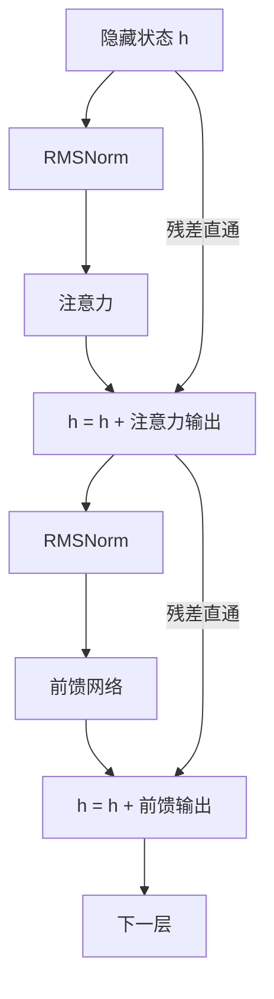

## Q
Transformer 里的残差连接（residual connection）和归一化（normalization）为什么必不可少？在推理实现里它们会引出哪些 bug？

## A
**残差连接：每个子部件的输出加回输入，`h = h + f(h)`。**
- **为什么需要：** 几十层串起来时，如果每层都完全替换上一层的结果，训练时信号会层层衰减或放大，深层网络学不动。加回去之后，信息有一条"直通路"，每层只需学一个小的修正量。
- **结果：** 隐藏状态（贯穿全模型的那条 4,096 维向量）的数值会随层数累积变大。

**归一化（RMSNorm）：把向量缩放到稳定的大小。**
- **公式：** 每个元素除以全体元素的均方根 `sqrt(mean(x²) + ε)`，再乘一个可学习的缩放向量。ε 是防止除以 0 的小常数，比如 1e-5 或 1e-6。
- **为什么需要：** 注意力和前馈网络的输入大小稳定，训练才稳定；推理时也能防止数值溢出。
- **另一种是 LayerNorm：** 还要减去均值，GPT-2 和 BERT 用它；Llama 系列用更简单的 RMSNorm。

**推理实现里常见的 bug：**
- **ε 取错：** 配置里是 `rms_norm_eps: 1e-5`，实现里写死 1e-6。结果整体只有微小偏差，短文本看不出，长文本或某些输入下逐渐偏离。
- **归一化用了低精度：** 平方和在 16 位浮点数里累加，长向量会损失精度甚至溢出。正确做法是转成 FP32 计算再转回。
- **融合实现的残差顺序错误：** 为了加速，推理引擎常把"相加 + 归一化"合并成一个操作，并把相加后的结果另存一份供下一次残差使用。存错了哪一份，输出会逐层跑偏。
- **定位方法：** 逐层导出隐藏状态，和参考实现比较。残差导致误差累积，看"差异第一次明显跳升"的那一层。
