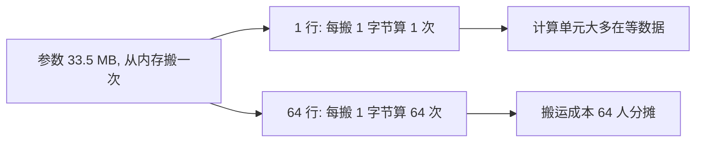

## Q
同样做矩阵乘法，"一次处理 1 行"和"一次处理 64 行"，在硬件上的代价为什么差别很大？这和推理服务里的"批"（batch）有什么关系？

## A
关键在于：**做乘法之前，参数矩阵必须先从内存搬到计算单元**。搬数据和做乘法是两笔不同的账。

- **一行乘矩阵（矩阵乘向量）：** 输入 `[1, 4096]`，参数 `[4096, 4096]`。要搬 1677 万个参数（FP16 每个 2 字节，约 33.5 MB），只做 3355 万次运算，**每搬 1 字节只算 1 次**。
- **64 行乘矩阵：** 输入 `[64, 4096]`，参数还是那 33.5 MB，只搬一次，运算量变成 64 倍。**每搬 1 字节算 64 次**。
- **硬件的现实：** 一块现代 AI 显卡每秒能做约 1000 万亿次运算，却只能每秒搬约 3 万亿字节。也就是说，每搬 1 字节，它有能力算约 300 次。只算 1 次时，绝大多数计算单元在等数据。
- **批（batch）就是这个道理：** 把多个用户的请求叠成一个矩阵一起算，就叫成批处理。读一遍参数，同时服务 64 个人，每个人分摊的搬运成本降到 1/64。
- **代价：** 批越大，每一步算得越久，凑批也要等，单个用户感受到的速度会变慢；而且每个请求都要占内存存它的中间结果，批不能无限大。

一句话：小批量时瓶颈是"搬数据"，大批量时瓶颈才变成"做乘法"。大模型推理服务的很多优化，都是在想办法让一次搬运服务更多计算。
